# Component — server process

Audited against landed main `643b706` on 2026-10-11 (item 27); updated for FFI-01 to FFI-05 at `f2bf1c9` on
2026-10-14; FFI-06 at `5c2a499` changes only the runtime note on `path`. Both formats are generated from
`diagrams/c4-component-server.py`; numbered relationships are identical. All boxes describe landed code.

```mermaid
flowchart TB
    subgraph platform["Server process: PlatformLive"]
        http["HTTP API / auth<br/>[Component]<br/>platform/http/; platform/auth/; core/errors.ts<br/>Named routes, traces, tenant/API-key/session authentication; toHttpStatus maps StatementDeadlineError to 504"]
        life["Server lifecycle<br/>[Component]<br/>platform/server.ts<br/>Scoped listener, backup and ingest timers, reader-exit watch"]
        apps["AppRegistry / AppServices<br/>[Effect services]<br/>platform/registry.ts; platform/layers.ts<br/>App schema/handlers; Storage and Backups stack per app"]
        tenant["TenantRegistry<br/>[Effect service]<br/>platform/tenants/store.ts<br/>Lazy Postgres registry; bounded hashed-key TTL cache"]
        route["TenantStorageRouter<br/>[Effect service]<br/>platform/tenants/routing.ts<br/>LocalFolderRouter per app; validated locations"]
        context["TenantContext<br/>[Request-local Effect service]<br/>platform/tenants/routing.ts<br/>Trusted credential-derived tenant id; scoped continuation"]
        storage["Storage<br/>[Effect service]<br/>platform/sqlite.ts<br/>Scoped handles; serialization; rollback and context expiry; ConnectionGate; unbounded reads under the statement deadline"]
        backup["Backups / ObjectStore<br/>[Effect services]<br/>platform/backup.ts; platform/object_store.ts<br/>Snapshot/hash/manifest; local or signed S3"]
        rpc["ReaderClient / ReaderProcess<br/>[Effect services]<br/>platform/ipc.ts; platform/layers.ts<br/>Scoped child for ingest/analysis; capped queue, deadline, trace"]
        docread["DocumentReaderClient<br/>[Effect service]<br/>platform/document_reader.ts; platform/sqlite.ts (ConnectionGate)<br/>In-process SQLite queries; read-only connection; concurrency cap 32; ConnectionGate; unbounded selects under the statement deadline"]
        ffi["FFI SQLite binding<br/>[Library in server process]<br/>platform/sqlite_ffi/<br/>System libsqlite3 via Deno.dlopen; every server SQLite open goes through it (FFI-04), node:sqlite is not loaded. Every open applies node:sqlite-compatible defaults (double-quoted strings off, foreign keys on); darwin/aarch64 refused. Blocking path (main thread) for writes and point reads; nonblocking path (allAsync/getAsync on the blocking pool, sqlite3_interrupt at the deadline) for unbounded reads (FFI-05); 64-statement cache"]
        classify["Statement classifier<br/>[Pure function]<br/>platform/sqlite_ffi/classify.ts<br/>classify(operation) from the plan IR, never SQL text: insert, patch, delete and a select with _id equality and no aggregate are bounded (blocking path); every other select, count and countBy is unbounded (nonblocking path)"]
        logging["Logger / EventSink<br/>[Effect logger/service]<br/>platform/logging/<br/>Dropping queue; batched JSONL; final drain"]
        config["Config / IdGen<br/>[Effect services]<br/>platform/config.ts; platform/sqlite.ts<br/>Validated options (sqlite.library, sqlite.statementDeadlineMs and sqlite.statementInterruptGraceMs are all read); UUIDs; Clock"]
    end
        pg["Central registry<br/>[Postgres process/store]<br/>DATABASE_URL<br/>Tenant/key and headless auth data"]
        files["Application files<br/>[SQLite 3 WAL]<br/>DATA_DIR; TENANTS_DIR<br/>Legacy app files or tenant locations"]
        reader["Reader child<br/>[Deno process]<br/>platform/reader.ts<br/>DuckDB event-log ingest and named analysis"]
        objects["Object storage<br/>[External system / filesystem]<br/>S3_BASE_URL or LOCAL_OBJECT_DIR<br/>Snapshot and manifest objects"]
        jsonl["Server JSONL<br/>[Filesystem]<br/>LOG_DIR/server/date/<br/>Durable structured records"]
    http -->|"(1) Resolve app and named handler"| apps
    http -->|"(2) Resolve hashed credentials; admin tenant/key CRUD"| tenant
    http -->|"(3) Better Auth session/registration SQL"| pg
    http -->|"(4) Provide authenticated tenant per request"| context
    context -->|"(5) Resolve tenant writer; never use caller selectors"| storage
    apps -->|"(6) Build per-app LocalFolderRouter"| route
    route -->|"(7) Open and prepare validated tenant SQLite file; schema guard"| ffi
    storage -->|"(8) Resolve/prepare tenant location before opening a cached writer"| route
    http -->|"(9) Mutation Effect inside serialized transaction"| storage
    http -->|"(10) Document query in-process; compiled SQLite SQL"| docread
    docread -->|"(11) Resolve registered query, schema and file"| apps
    docread -->|"(12) Read-only connection and transaction; point reads blocking, other selects allAsync under the deadline; prepared-statement cache"| ffi
    docread -->|"(13) Pick the path of each select from its plan"| classify
    http -->|"(14) Ingest/analysis RPC; trace context"| rpc
    storage -->|"(15) Writer connection, transactions and snapshot reads; writes and point reads blocking, unbounded reads allAsync/getAsync under the deadline"| ffi
    storage -->|"(16) Pick the path of each handler read from its plan"| classify
    life -->|"(17) Scoped backup timer"| backup
    backup -->|"(18) Consistent VACUUM INTO snapshot"| storage
    backup -->|"(19) Read-only quick_check of the snapshot copy before publication"| ffi
    backup -->|"(20) Verified snapshot and manifest publication"| objects
    tenant -->|"(21) Parameterized registry SQL; lazy scoped pool"| pg
    life -->|"(22) Ping; hourly ingest; reader-exit watch and finalizer"| rpc
    rpc -->|"(23) JSONL RPC; scoped child shutdown"| reader
    storage -->|"(24) SQL/tx/queue events (each sql event carries its path); error lifecycle event for a stuck statement"| logging
    docread -->|"(25) SQL/tx events (with path); error lifecycle event for a stuck statement"| logging
    http -->|"(26) HTTP/handler spans and failures"| logging
    life -->|"(27) Startup/shutdown and timer events"| logging
    backup -->|"(28) Backup and object-transfer events"| logging
    logging -->|"(29) Batched append; rotation and scope drain"| jsonl
    config -->|"(30) App schemas, tokens and paths; generated ids"| apps
    config -->|"(31) DATABASE_URL and scope-owned cache"| tenant
    config -->|"(32) TENANTS_DIR and router selection"| route
    config -->|"(33) Level, queue, flush and rotation settings"| logging
    config -->|"(34) sqlite.library: the libsqlite3 path passed to every open"| ffi
    config -->|"(35) sqlite.statementDeadlineMs and statementInterruptGraceMs: deadline and interrupt grace of unbounded reads"| storage
    config -->|"(36) sqlite.statementDeadlineMs and statementInterruptGraceMs: deadline and interrupt grace of unbounded selects"| docread
    apps -->|"(37) Load libsqlite3 once at startup; sqlite-library lifecycle event names path and version"| ffi
    ffi -->|"(38) libsqlite3 file I/O; WAL transactions and read-only snapshots"| files
    classDef planned stroke-dasharray: 5 3
    classDef person fill:#fff,stroke-width:2px
    classDef external fill:#f4f4f4
    class pg external
    class files external
    class reader external
    class objects external
    class jsonl external
```

## Relationships

| #  | From                         | To                           | Relationship                                                                                                                              |
| -- | ---------------------------- | ---------------------------- | ----------------------------------------------------------------------------------------------------------------------------------------- |
| 1  | HTTP API / auth              | AppRegistry / AppServices    | Resolve app and named handler                                                                                                             |
| 2  | HTTP API / auth              | TenantRegistry               | Resolve hashed credentials; admin tenant/key CRUD                                                                                         |
| 3  | HTTP API / auth              | Central registry             | Better Auth session/registration SQL                                                                                                      |
| 4  | HTTP API / auth              | TenantContext                | Provide authenticated tenant per request                                                                                                  |
| 5  | TenantContext                | Storage                      | Resolve tenant writer; never use caller selectors                                                                                         |
| 6  | AppRegistry / AppServices    | TenantStorageRouter          | Build per-app LocalFolderRouter                                                                                                           |
| 7  | TenantStorageRouter          | FFI SQLite binding           | Open and prepare validated tenant SQLite file; schema guard                                                                               |
| 8  | Storage                      | TenantStorageRouter          | Resolve/prepare tenant location before opening a cached writer                                                                            |
| 9  | HTTP API / auth              | Storage                      | Mutation Effect inside serialized transaction                                                                                             |
| 10 | HTTP API / auth              | DocumentReaderClient         | Document query in-process; compiled SQLite SQL                                                                                            |
| 11 | DocumentReaderClient         | AppRegistry / AppServices    | Resolve registered query, schema and file                                                                                                 |
| 12 | DocumentReaderClient         | FFI SQLite binding           | Read-only connection and transaction; point reads blocking, other selects allAsync under the deadline; prepared-statement cache           |
| 13 | DocumentReaderClient         | Statement classifier         | Pick the path of each select from its plan                                                                                                |
| 14 | HTTP API / auth              | ReaderClient / ReaderProcess | Ingest/analysis RPC; trace context                                                                                                        |
| 15 | Storage                      | FFI SQLite binding           | Writer connection, transactions and snapshot reads; writes and point reads blocking, unbounded reads allAsync/getAsync under the deadline |
| 16 | Storage                      | Statement classifier         | Pick the path of each handler read from its plan                                                                                          |
| 17 | Server lifecycle             | Backups / ObjectStore        | Scoped backup timer                                                                                                                       |
| 18 | Backups / ObjectStore        | Storage                      | Consistent VACUUM INTO snapshot                                                                                                           |
| 19 | Backups / ObjectStore        | FFI SQLite binding           | Read-only quick_check of the snapshot copy before publication                                                                             |
| 20 | Backups / ObjectStore        | Object storage               | Verified snapshot and manifest publication                                                                                                |
| 21 | TenantRegistry               | Central registry             | Parameterized registry SQL; lazy scoped pool                                                                                              |
| 22 | Server lifecycle             | ReaderClient / ReaderProcess | Ping; hourly ingest; reader-exit watch and finalizer                                                                                      |
| 23 | ReaderClient / ReaderProcess | Reader child                 | JSONL RPC; scoped child shutdown                                                                                                          |
| 24 | Storage                      | Logger / EventSink           | SQL/tx/queue events (each sql event carries its path); error lifecycle event for a stuck statement                                        |
| 25 | DocumentReaderClient         | Logger / EventSink           | SQL/tx events (with path); error lifecycle event for a stuck statement                                                                    |
| 26 | HTTP API / auth              | Logger / EventSink           | HTTP/handler spans and failures                                                                                                           |
| 27 | Server lifecycle             | Logger / EventSink           | Startup/shutdown and timer events                                                                                                         |
| 28 | Backups / ObjectStore        | Logger / EventSink           | Backup and object-transfer events                                                                                                         |
| 29 | Logger / EventSink           | Server JSONL                 | Batched append; rotation and scope drain                                                                                                  |
| 30 | Config / IdGen               | AppRegistry / AppServices    | App schemas, tokens and paths; generated ids                                                                                              |
| 31 | Config / IdGen               | TenantRegistry               | DATABASE_URL and scope-owned cache                                                                                                        |
| 32 | Config / IdGen               | TenantStorageRouter          | TENANTS_DIR and router selection                                                                                                          |
| 33 | Config / IdGen               | Logger / EventSink           | Level, queue, flush and rotation settings                                                                                                 |
| 34 | Config / IdGen               | FFI SQLite binding           | sqlite.library: the libsqlite3 path passed to every open                                                                                  |
| 35 | Config / IdGen               | Storage                      | sqlite.statementDeadlineMs and statementInterruptGraceMs: deadline and interrupt grace of unbounded reads                                 |
| 36 | Config / IdGen               | DocumentReaderClient         | sqlite.statementDeadlineMs and statementInterruptGraceMs: deadline and interrupt grace of unbounded selects                               |
| 37 | AppRegistry / AppServices    | FFI SQLite binding           | Load libsqlite3 once at startup; sqlite-library lifecycle event names path and version                                                    |
| 38 | FFI SQLite binding           | Application files            | libsqlite3 file I/O; WAL transactions and read-only snapshots                                                                             |

## Runtime notes

Config is acquired before logging, then IdGen, ObjectStore/AppRegistry, TenantRegistry, AppServices and
ReaderClient. Shutdown drains HTTP, stops timers, closes reader and DB handles, emits the final lifecycle
event, then drains logging. Every partial startup releases acquired resources. Auth derives TenantContext
before consuming app arguments; the tenant SQLite location is prepared behind a shared initialization barrier.
Tenant key revocation invalidates the local cache; other instances converge within its TTL. Tenant-mode
writers use a bounded scope-owned handle cache (default 64 handles, 60-second idle expiry); requests lease
handles, and shutdown drains leases before closing them. Retention and named analysis execute in the reader,
never as server-side DuckDB components. Item 26 removes compatibility wrappers and platform/compiler.ts; pure
compilation now lives in core/compile/ and introduces no new runtime component. HTTP status mapping lives in
core/errors.ts. Better Auth connections are bounded to each request/CLI operation, separate from the lazy
registry pool. FFI-04: Storage, DocumentReaderClient, TenantStorageRouter and the backup verifier open SQLite
only through the FFI binding, on Config.sqlite.library; node:sqlite is not in the server runtime graph
(tests/unit/boundaries_test.ts). Startup loads libsqlite3 once and logs a lifecycle event, phase
sqlite-library, with the resolved path and version. FFI-04b: every FFI open, read-only included, applies
node:sqlite-compatible connection defaults (double-quoted string literals off, foreign_keys on) before any
caller SQL, and loadLibrary refuses darwin/aarch64. FFI-05: the classifier (platform/sqlite_ffi/classify.ts)
picks one of two execution paths per document operation from the plan IR. Blocking: writes, primary-key
selects and the writer's pragmas, DDL, BEGIN/COMMIT/ROLLBACK and VACUUM INTO run on the main thread, never
interrupted. Nonblocking: every other select, count and countBy (and the writer's U+0000 probe of such a
select) runs allAsync/getAsync on Deno's blocking pool under Config.sqlite.statementDeadlineMs. At the
deadline the binding calls sqlite3_interrupt and the statement fails StatementDeadlineError, which
toHttpStatus maps to HTTP 504 (core/errors.ts). Writes never take the nonblocking path: an interrupt landing
after an async write committed would leave the commit standing while the caller saw a failure. The call-level
reader.callTimeoutMs guard stays; config validation keeps the statement deadline below it, so the deadline
fires first. A per-connection ConnectionGate (platform/sqlite.ts, shared by Storage and the document reader)
keeps one statement at a time on a connection: while an async read is in flight, every other statement (a
forked fiber's, COMMIT, the release's ROLLBACK) waits instead of failing the binding's busy refusal. A step
that has not returned Config.sqlite.statementInterruptGraceMs after its interrupt poisons the connection: an
error-level lifecycle event (phase "statement did not return after interrupt"), no further statements, and the
connection closes when the step returns. Every sql event carries path (blocking or nonblocking); since FFI-06
it is written to the JSONL line and to the nullable sql_events.path column (see the observability container
diagram).
