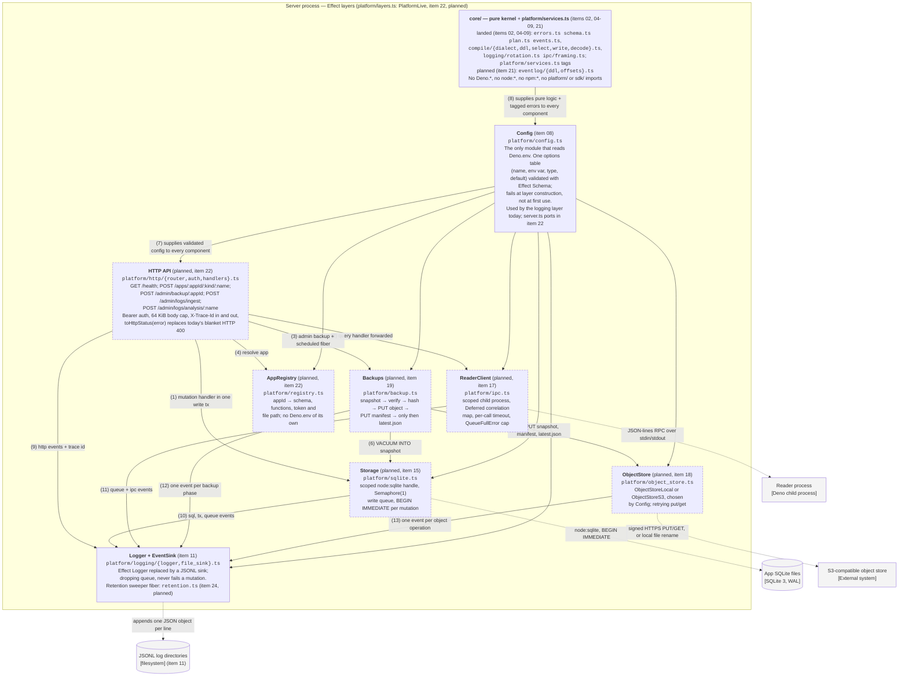

# C4 Level 3 — Component: inside the server process

GitHub/Mermaid rendering. The same diagram as box-drawing for a terminal:
[`c4-component-server.terminal.md`](c4-component-server.terminal.md).

The container this expands is the **Server process** in
[`c4-container-platform.github.md`](c4-container-platform.github.md).

## What this shows

The Effect services and layers that make up the server process after the port, and how they depend on each
other. Read it bottom-up: `core/` is pure, `Config` is the only thing that touches the environment, and each
tier above is provided by the tiers below it. `platform/layers.ts` composes the whole stack as `PlatformLive`.

**The bottom three tiers are built; the top two are planned.** Items 02 and 04–09 landed the pure kernel
(`core/errors.ts`, `schema.ts`, `plan.ts`, `events.ts`, `compile/*`, `logging/rotation.ts`, `ipc/framing.ts`)
and the `platform/services.ts` `Context.Tag` declarations; item 08 landed `ConfigLive`/`ConfigTest`; item 11
landed the `EventSink` service and the JSONL `Logger` layer, which is the first live layer to consume
`Config`. Nothing above that tier is a service yet: `platform/server.ts` is still the pre-port code (classes,
top-level `await`, its own `Deno.env` reads) and does **not** mount `ConfigLive` or `LoggingLive` until item
22, so at runtime the landed layers are exercised only by their unit tests. The pre-port code does already
call into `core/` — `platform/compiler.ts` wraps `core/compile/*`, `platform/ipc.ts` uses
`core/ipc/framing.ts`, `sdk/` uses `core/schema.ts` and `core/plan.ts`. The plan item number in each box says
which item turns it into a service. Plan:
[`docs/plans/effect-port-and-observability.md`](../plans/effect-port-and-observability.md), §1.2 for the
service table and §1.3 for the error channel.

## Relationships

| #  | From         | To                    | What it depends on it for                                                                                                                                                                                                                                                                                                                                                                                |
| -- | ------------ | --------------------- | -------------------------------------------------------------------------------------------------------------------------------------------------------------------------------------------------------------------------------------------------------------------------------------------------------------------------------------------------------------------------------------------------------- |
| 1  | HTTP API     | Storage               | Runs a `mutation` handler. One per-app queue slot, one `BEGIN IMMEDIATE … COMMIT`; the handler's own reads execute inside that transaction. `Effect.acquireUseRelease` means a defect _or an interruption_ rolls back, which the current try/catch does not handle.                                                                                                                                      |
| 2  | HTTP API     | ReaderClient          | Forwards a `query` handler to the reader process and awaits the correlated reply. A `kind` mismatch between the route and the handler is a 400.                                                                                                                                                                                                                                                          |
| 3  | HTTP API     | Backups               | `POST /admin/backup/<appId>` behind the admin token, plus the periodic sweep — `Effect.schedule(Schedule.spaced(interval))` in a `forkScoped` fiber, replacing today's `setInterval` and its re-entrancy guard.                                                                                                                                                                                          |
| 4  | HTTP API     | AppRegistry           | Resolve `appId` to its schema, handler map, bearer token and database file path, or fail `UnknownAppError` → 404.                                                                                                                                                                                                                                                                                        |
| 5  | Backups      | ObjectStore           | PUT the immutable snapshot, PUT its manifest, and **only then** PUT `latest.json`. A failed upload must not advance `latest.json`.                                                                                                                                                                                                                                                                       |
| 6  | Backups      | Storage               | `VACUUM INTO` a consistent snapshot, including uncheckpointed WAL commits. Snapshot creation takes the mutation queue slot; the upload does not.                                                                                                                                                                                                                                                         |
| 7  | Config       | every component above | Validated configuration, read from `Deno.env` **once** at layer construction. A bad value fails startup with `ConfigError` and is never served. Landed: `ConfigLive`/`ConfigTest` (item 08) and the one consumer that exists, `LoggingLive` (item 11). The other arrows are planned with their targets (items 15–19, 22).                                                                                |
| 8  | `core/`      | every component       | Total, `Either`-returning schema validation, SQL compilation, plan normalisation, event construction and the `Data.TaggedError` taxonomy that `toHttpStatus` maps to a status code. Landed into `Config` (`ConfigError`) and `Logger + EventSink` (`core/events.ts`, `core/logging/rotation.ts`); the pre-port `platform/*.ts` reaches `core/` through the compatibility seam in `platform/compiler.ts`. |
| 9  | HTTP API     | Logger + EventSink    | One `http` event per request (method, path, app, handler, status, duration, bytes in/out), with the request's trace id annotated onto its fiber so every downstream event carries it.                                                                                                                                                                                                                    |
| 10 | Storage      | Logger + EventSink    | `sql` events per statement, `tx` events per transaction (commit/rollback/interrupted), `queue` events on rejection. Replaces `platform/registry.ts:trace` and `TRACE_SQL=1`.                                                                                                                                                                                                                             |
| 11 | ReaderClient | Logger + EventSink    | `queue` events for depth high-water marks and rejections; a reply to an unknown request id is logged as an anomaly rather than silently dropped.                                                                                                                                                                                                                                                         |
| 12 | Backups      | Logger + EventSink    | One event per phase — `snapshot`, `verify`, `hash`, `put-object`, `put-manifest`, `publish-latest` — with durations, so a stalled backup is visible.                                                                                                                                                                                                                                                     |
| 13 | ObjectStore  | Logger + EventSink    | One event per object operation: key, bytes, duration, outcome.                                                                                                                                                                                                                                                                                                                                           |

Edges 1–8 are drawn in both renderings. Edges 9–13 all terminate at `Logger + EventSink`; the Mermaid
rendering draws them, and the terminal rendering lists them here instead of drawing five crossing arrows. The
sets are identical.

### Crossing the container boundary

| From               | To                              | Over what                                                 |
| ------------------ | ------------------------------- | --------------------------------------------------------- |
| Storage            | App SQLite files                | `node:sqlite` `DatabaseSync`, write transactions          |
| ReaderClient       | Reader process                  | spawned child, JSON-lines RPC on stdin/stdout             |
| ObjectStore        | S3-compatible object store      | signed HTTPS `PUT`/`GET`, or a local temp-file + `rename` |
| Logger + EventSink | JSONL log directories (item 11) | append-only writes to the current dated file              |

## Reading the arrow direction

Arrows 7 and 8 point **up**, from `Config` and `core/` into the components above them. That is the Effect
layer-composition direction: `core/` is provided to `Config`, `Config` is provided to every service, and
`platform/layers.ts` merges them into `PlatformLive` with `Layer.memoize` where a dependency is shared. Read
"A → B" here as "A is provided to B", which for every other edge in the diagram coincides with "B calls A".

## What the port buys, and the two behaviour changes

The payoff is testability: every box is a `Context.Tag` with a live layer and a test layer, so
`tests/unit/http_test.ts` can exercise the **whole router** over `StorageTest` + `ReaderTest` +
`ObjectStoreTest` with no subprocess and no DuckDB (plan items 20, 22).

Two changes are not refactors and are visible to callers, mapped by `toHttpStatus`:

- a stale `_version` becomes **409 Conflict** (today a 400 with a matched error string);
- a full writer or reader queue becomes **503 Service Unavailable** (today an untyped rejection).

## Not in this diagram

- **The reader process's own components** (`Reader`, `EventLogIngest`, `Analysis`) compose into a separate
  root, `ReaderLive`. They belong in a `c4-component-reader` diagram, not this one.
- **The pure modules inside `core/`** are shown as one box. Their internal structure is Level 4 material and
  is not worth a diagram yet — the directory listing in the box says as much as a picture would.
