# Component — server process

Audited against landed main `643b706` on 2026-10-11 (item 27). Both formats are generated from
`diagrams/c4-component-server.py`; numbered relationships are identical. All boxes describe landed code.

```mermaid
flowchart TB
    subgraph platform["Server process: PlatformLive"]
        http["HTTP API / auth<br/>[Component]<br/>platform/http/; platform/auth/<br/>Named routes, traces, tenant/API-key/session authentication"]
        life["Server lifecycle<br/>[Component]<br/>platform/server.ts<br/>Scoped listener, backup and ingest timers, reader supervision"]
        apps["AppRegistry / AppServices<br/>[Effect services]<br/>platform/registry.ts; platform/layers.ts<br/>App schema/handlers; Storage and Backups stack per app"]
        tenant["TenantRegistry<br/>[Effect service]<br/>platform/tenants/store.ts<br/>Lazy Postgres registry; bounded hashed-key TTL cache"]
        route["TenantStorageRouter<br/>[Effect service]<br/>platform/tenants/routing.ts<br/>LocalFolderRouter per app; validated locations"]
        context["TenantContext<br/>[Request-local Effect service]<br/>platform/tenants/routing.ts<br/>Trusted credential-derived tenant id; scoped continuation"]
        storage["Storage<br/>[Effect service]<br/>platform/sqlite.ts<br/>Scoped handles; serialization; rollback and context expiry"]
        backup["Backups / ObjectStore<br/>[Effect services]<br/>platform/backup.ts; platform/object_store.ts<br/>Snapshot/hash/manifest; local or signed S3"]
        rpc["ReaderClient / ReaderProcess<br/>[Effect services]<br/>platform/ipc.ts; platform/layers.ts<br/>Scoped child, capped queue, deadline, trace/tenant frames"]
        logging["Logger / EventSink<br/>[Effect logger/service]<br/>platform/logging/<br/>Dropping queue; batched JSONL; final drain"]
        config["Config / IdGen<br/>[Effect services]<br/>platform/config.ts; platform/sqlite.ts<br/>Validated options; UUIDs; Effect runtime Clock"]
    end
        pg["Central registry<br/>[Postgres process/store]<br/>DATABASE_URL<br/>Tenant/key and headless auth data"]
        files["Application files<br/>[SQLite 3 WAL]<br/>DATA_DIR; TENANTS_DIR<br/>Legacy app files or tenant locations"]
        reader["Reader child<br/>[Deno process]<br/>platform/reader.ts<br/>DuckDB reads, ingest and analysis"]
        objects["Object storage<br/>[External system / filesystem]<br/>S3_BASE_URL or LOCAL_OBJECT_DIR<br/>Snapshot and manifest objects"]
        jsonl["Server JSONL<br/>[Filesystem]<br/>LOG_DIR/server/date/<br/>Durable structured records"]
    http -->|"(1) Resolve app and named handler"| apps
    http -->|"(2) Resolve hashed credentials; admin tenant/key CRUD"| tenant
    http -->|"(3) Better Auth session/registration SQL"| pg
    http -->|"(4) Provide authenticated tenant per request"| context
    context -->|"(5) Resolve tenant writer; never use caller selectors"| storage
    apps -->|"(6) Build per-app LocalFolderRouter"| route
    route -->|"(7) Prepare validated SQLite capability and schema"| files
    storage -->|"(8) Resolve/prepare tenant location before opening a cached writer"| route
    http -->|"(9) Mutation Effect inside serialized transaction"| storage
    http -->|"(10) Query/ingest/analysis frames; trace and trusted tenant path"| rpc
    storage -->|"(11) node:sqlite transaction and snapshot reads"| files
    life -->|"(12) Scoped backup timer"| backup
    backup -->|"(13) Consistent VACUUM INTO snapshot"| storage
    backup -->|"(14) Verified snapshot and manifest publication"| objects
    tenant -->|"(15) Parameterized registry SQL; lazy scoped pool"| pg
    life -->|"(16) Ping; hourly ingest; reader supervision (restart/backoff)"| rpc
    rpc -->|"(17) JSONL RPC; supervised child (restart on exit)"| reader
    storage -->|"(18) SQL/tx/queue events"| logging
    http -->|"(19) HTTP/handler spans and failures"| logging
    life -->|"(20) Startup/shutdown and timer events"| logging
    backup -->|"(21) Backup and object-transfer events"| logging
    logging -->|"(22) Batched append; rotation and scope drain"| jsonl
    config -->|"(23) App schemas, tokens and paths; generated ids"| apps
    config -->|"(24) DATABASE_URL and scope-owned cache"| tenant
    config -->|"(25) TENANTS_DIR and router selection"| route
    config -->|"(26) Level, queue, flush and rotation settings"| logging
    classDef planned stroke-dasharray: 5 3
    classDef person fill:#fff,stroke-width:2px
    classDef external fill:#f4f4f4
    class pg external
    class files external
    class reader external
    class objects external
    class jsonl external
```

## Relationships

| #  | From                         | To                           | Relationship                                                   |
| -- | ---------------------------- | ---------------------------- | -------------------------------------------------------------- |
| 1  | HTTP API / auth              | AppRegistry / AppServices    | Resolve app and named handler                                  |
| 2  | HTTP API / auth              | TenantRegistry               | Resolve hashed credentials; admin tenant/key CRUD              |
| 3  | HTTP API / auth              | Central registry             | Better Auth session/registration SQL                           |
| 4  | HTTP API / auth              | TenantContext                | Provide authenticated tenant per request                       |
| 5  | TenantContext                | Storage                      | Resolve tenant writer; never use caller selectors              |
| 6  | AppRegistry / AppServices    | TenantStorageRouter          | Build per-app LocalFolderRouter                                |
| 7  | TenantStorageRouter          | Application files            | Prepare validated SQLite capability and schema                 |
| 8  | Storage                      | TenantStorageRouter          | Resolve/prepare tenant location before opening a cached writer |
| 9  | HTTP API / auth              | Storage                      | Mutation Effect inside serialized transaction                  |
| 10 | HTTP API / auth              | ReaderClient / ReaderProcess | Query/ingest/analysis frames; trace and trusted tenant path    |
| 11 | Storage                      | Application files            | node:sqlite transaction and snapshot reads                     |
| 12 | Server lifecycle             | Backups / ObjectStore        | Scoped backup timer                                            |
| 13 | Backups / ObjectStore        | Storage                      | Consistent VACUUM INTO snapshot                                |
| 14 | Backups / ObjectStore        | Object storage               | Verified snapshot and manifest publication                     |
| 15 | TenantRegistry               | Central registry             | Parameterized registry SQL; lazy scoped pool                   |
| 16 | Server lifecycle             | ReaderClient / ReaderProcess | Ping; hourly ingest; reader supervision (restart/backoff)      |
| 17 | ReaderClient / ReaderProcess | Reader child                 | JSONL RPC; supervised child (restart on exit)                  |
| 18 | Storage                      | Logger / EventSink           | SQL/tx/queue events                                            |
| 19 | HTTP API / auth              | Logger / EventSink           | HTTP/handler spans and failures                                |
| 20 | Server lifecycle             | Logger / EventSink           | Startup/shutdown and timer events                              |
| 21 | Backups / ObjectStore        | Logger / EventSink           | Backup and object-transfer events                              |
| 22 | Logger / EventSink           | Server JSONL                 | Batched append; rotation and scope drain                       |
| 23 | Config / IdGen               | AppRegistry / AppServices    | App schemas, tokens and paths; generated ids                   |
| 24 | Config / IdGen               | TenantRegistry               | DATABASE_URL and scope-owned cache                             |
| 25 | Config / IdGen               | TenantStorageRouter          | TENANTS_DIR and router selection                               |
| 26 | Config / IdGen               | Logger / EventSink           | Level, queue, flush and rotation settings                      |

## Runtime notes

Config is acquired before logging, then IdGen, ObjectStore/AppRegistry, TenantRegistry, AppServices and
ReaderClient. Shutdown drains HTTP, stops timers, closes reader and DB handles, emits the final lifecycle
event, then drains logging. Every partial startup releases acquired resources. Auth derives TenantContext
before consuming app arguments; the trusted reader location is prepared behind a shared initialization
barrier. Tenant key revocation invalidates the local cache; other instances converge within its TTL.
Tenant-mode writers use a bounded scope-owned handle cache (default 64 handles, 60-second idle expiry);
requests lease handles, and shutdown drains leases before closing them. Retention and named analysis execute
in the reader, never as server-side DuckDB components. Item 26 removes compatibility wrappers and
platform/compiler.ts; pure compilation now lives in core/compile/ and introduces no new runtime component.
HTTP status mapping lives in core/errors.ts. Better Auth connections are bounded to each request/CLI
operation, separate from the lazy registry pool. Reader supervision: unexpected reader exit restarts the child
with backoff (1s-8s, 502s during the window); more than 5 restarts in 10 minutes gives up and shuts down.
