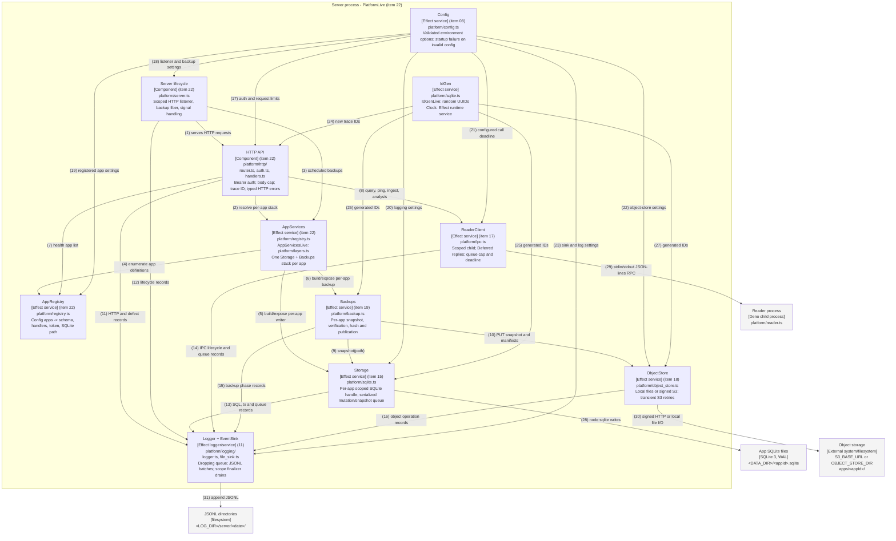

# C4 Level 3 — Component: inside the server process

Renderings: [GitHub](c4-component-server.github.md) · [terminal](c4-component-server.terminal.md).

## What this shows

The live server composition is `PlatformLive` in `platform/layers.ts` (item 22). The HTTP router resolves
per-app stacks through `AppServices`; it is not provided a single global `Storage`. All components shown
inside the boundary are implemented and mounted. The reader and persistent stores are boundary elements. The
pure kernel and service tags are compile-time modules used by these components, not runtime services.

## Relationships

All arrows are listed here in both formats. The terminal uses this key instead of crossing lines.

| #  | From               | To                 | Relationship                                                                                                                    |
| -- | ------------------ | ------------------ | ------------------------------------------------------------------------------------------------------------------------------- |
| 1  | Server lifecycle   | HTTP API           | `Deno.serve` invokes the router on the Effect runtime; shutdown drains requests before closing dependencies.                    |
| 2  | HTTP API           | AppServices        | Mutation and admin-backup handlers resolve `AppServices.get(appId)`, then call the stack storage or backups.                    |
| 3  | Server lifecycle   | AppServices        | A scoped `Schedule.spaced` fiber enumerates app stacks and calls backups sequentially. Disabled when `BACKUP_INTERVAL_MS=0`.    |
| 4  | AppServices        | AppRegistry        | `AppServicesLive` enumerates `AppRegistry.all` while building per-app stacks.                                                   |
| 5  | AppServices        | Storage            | One scoped writer per registered app, shared with that app's backups.                                                           |
| 6  | AppServices        | Backups            | `BackupsLive` is provided the matching `StorageLive`.                                                                           |
| 7  | HTTP API           | AppRegistry        | Health lists registered apps and pings the reader.                                                                              |
| 8  | HTTP API           | ReaderClient       | JSON RPC operations. Query and ping work; reader ingest and analysis return typed errors until wired.                           |
| 9  | Backups            | Storage            | `VACUUM INTO` serializes with mutations; verification and upload run after releasing the writer queue.                          |
| 10 | Backups            | ObjectStore        | Snapshot -> quick_check -> SHA-256 -> immutable object -> manifest -> latest.json. Failure cannot publish latest early.         |
| 11 | HTTP API           | Logger + EventSink | One HTTP record per request, trace ID echoed in the response. Router annotates its handler fiber.                               |
| 12 | Server lifecycle   | Logger + EventSink | Startup, stopping, HTTP drain and shutdown events. Shutdown marker runs before final log drain.                                 |
| 13 | Storage            | Logger + EventSink | SQL tracing honors configuration; failed statements and transaction outcomes are recorded.                                      |
| 14 | ReaderClient       | Logger + EventSink | ReaderClient uses its connection trace ID; request trace IDs do not currently cross IPC.                                        |
| 15 | Backups            | Logger + EventSink | Snapshot, verify, hash, put-manifest and publish-latest events; snapshot object PUT is normally recorded by ObjectStore.        |
| 16 | ObjectStore        | Logger + EventSink | PUT emits backup/put-object; GET emits lifecycle records, with outcome and duration.                                            |
| 17 | Config             | HTTP API           | The HTTP components consume the validated admin token and body-size limit.                                                      |
| 18 | Config             | Server lifecycle   | Bind host, port, backup interval and startup token warnings.                                                                    |
| 19 | Config             | AppRegistry        | App IDs, layouts, tokens and data directory.                                                                                    |
| 20 | Config             | Storage            | Storage consumes logging configuration; file/schema/appId arrive through AppServicesLive.                                       |
| 21 | Config             | ReaderClient       | `ReaderClientConfigured` reads `READER_CALL_TIMEOUT_MS` (default 30 seconds).                                                   |
| 22 | Config             | ObjectStore        | Local directory or S3 endpoint/credentials and signing region.                                                                  |
| 23 | Config             | Logger + EventSink | Directory, log level, queue capacity and file rotation policy.                                                                  |
| 24 | IdGen              | HTTP API           | Fallback when the presented X-Trace-Id is absent or invalid.                                                                    |
| 25 | IdGen              | Storage            | Document/event IDs from IdGen; times from Effect Clock.                                                                         |
| 26 | IdGen              | Backups            | Backup IDs and events; phase timings use Effect Clock.                                                                          |
| 27 | IdGen              | ObjectStore        | Temporary object names and operation events.                                                                                    |
| 28 | Storage            | App SQLite files   | `DatabaseSync`; one BEGIN IMMEDIATE transaction per mutation, including handler reads; scoped rollback on failure/interruption. |
| 29 | ReaderClient       | Reader process     | Child in its own process group; finalizer closes stdin, waits, then escalates SIGTERM/SIGKILL.                                  |
| 30 | ObjectStore        | Object storage     | S3 PUT/GET signed with aws4fetch, or local temp-file + rename publication.                                                      |
| 31 | Logger + EventSink | JSONL directories  | Batched append writes with per-role/date/hour/pid/sequence file names.                                                          |

## Runtime notes

- Layer acquisition is Config -> logging -> shutdown marker -> IdGen -> ObjectStore/AppRegistry -> AppServices
  -> ReaderClient; the program then starts the backup fiber and HTTP listener. Shutdown reverses this: HTTP
  drain, backup fiber, reader, DB handles, final lifecycle event, log drain. `Layer.provideMerge` enforces the
  dependency chain; normal layer-reference memoization shares services. There is no explicit `Layer.memoize`
  call.
- Pure dependencies in `core/` provide schema validation, plan normalization, SQL compilation/decoding,
  errors, events, IPC framing and rotation policy. Tags are declared in `platform/services.ts`, except
  `AppServices` in `platform/registry.ts`. These are module dependencies, not another layer service.
- Routes: `GET /health`, `POST /apps/:appId/:kind/:name`, `POST /admin/backup/:appId`,
  `POST /admin/logs/ingest`, `POST /admin/logs/analysis/:name`. Default body cap: 64 KiB. Conflict is 409,
  queue full is 503, body too large is 413; `core/errors.ts:toHttpStatus` maps typed failures.
- The reader stub yields `IngestError` (500) and `UnknownAnalysisQuery` (404). Its runtime logging root does
  not include `EventLogIngestLive`, regardless of the type alias in `platform/layers.ts`.
- The item-24 retention implementation in `platform/logging/retention.ts` is **not mounted** by this
  composition, so it is not drawn as an active server component. Items 30 and 35 are omitted.
- HTTP request trace annotations do not propagate over the current RPC frame. Reader-side events cannot be
  assumed to carry the HTTP trace ID. The IPC client also emits events under its own connection ID.
- `tests/unit/http_test.ts` exercises the router over in-memory services; components and TypeScript modules
  are distinguished here because the router and lifecycle program are not `Context.Tag`s.
