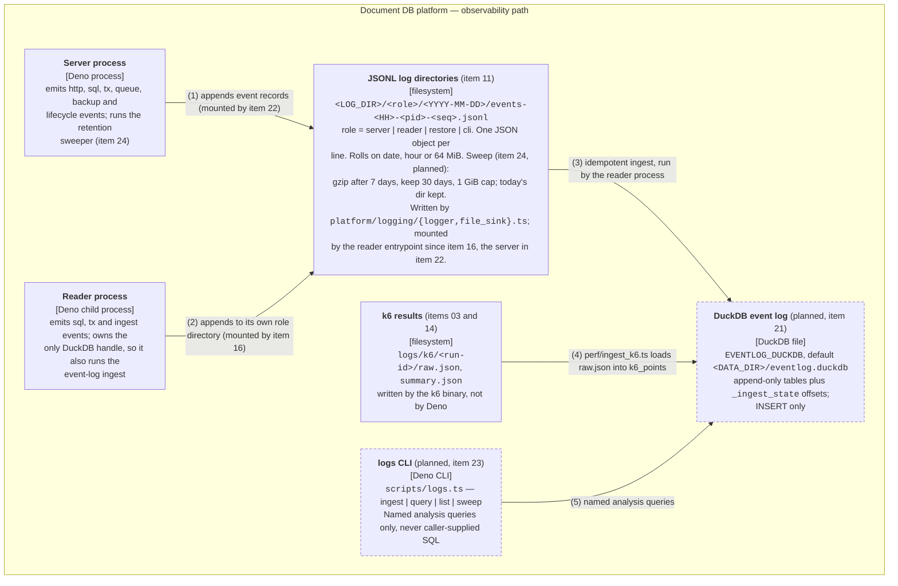

# C4 Level 2 — Container: the platform's observability path

GitHub/Mermaid rendering. The same diagram as box-drawing for a terminal:
[`c4-container-observability.terminal.md`](c4-container-observability.terminal.md).

The request and backup path is the companion Level 2 diagram:
[`c4-container-platform.github.md`](c4-container-platform.github.md).

## What this shows

Where platform events go: the rotating JSONL files both processes append to, the DuckDB file they are
materialised into, the k6 output that joins against them, and the CLI that queries the result.

**Half of this diagram is planned.** The two processes, the k6 results directory and the JSONL log directories
exist: item 11 landed the rotating JSONL sink and the `EventSink`/`Logger` layer in `platform/logging/`, built
on the pure rotation policy from item 06 and the event taxonomy from item 07. Since item 16 the **reader**
mounts that layer at runtime: `platform/reader.ts` is now an Effect program whose entrypoint provides
`ReaderProcessLive` (`LoggingReaderLive` under `ConfigLive`), so a running reader appends `sql`, `tx` and
ingest events to its own `<LOG_DIR>/reader/` directory with stdout reserved for the reply protocol.
`platform/server.ts` does not mount the layer until item 22, so the server's only observability surface is
still `TRACE_SQL=1`, which prints SQL to stderr from `platform/registry.ts:trace`. The DuckDB event log, the
`logs` CLI and the retention sweeper are plan items 21, 23 and 24 of
[`docs/plans/effect-port-and-observability.md`](../plans/effect-port-and-observability.md).

## Relationships

| # | From                  | To                    | What travels over it                                                                                                                                                                                                                                                                                                                                                                                                                                          |
| - | --------------------- | --------------------- | ------------------------------------------------------------------------------------------------------------------------------------------------------------------------------------------------------------------------------------------------------------------------------------------------------------------------------------------------------------------------------------------------------------------------------------------------------------- |
| 1 | Server process        | JSONL log directories | One JSON object per line, appended through a dropping `Queue` drained by a background fiber, so logging never blocks or fails a mutation. Drops are themselves logged as a `queue` event. Files roll on date, hour or `LOG_MAX_FILE_BYTES`. The layer (`LoggingLive` in `platform/logging/logger.ts`, item 11) exists and is unit-tested; `platform/server.ts` mounts it in item 22.                                                                          |
| 2 | Reader process        | JSONL log directories | The same sink (`LoggingReaderLive`) in its own `<LOG_DIR>/reader/` directory — the pid and sequence in the filename keep two concurrently writing processes from interleaving into one file. **Its stdout stays reserved for the RPC protocol.** `platform/reader.ts` mounts it since item 16 landed: `ReaderProcessLive` = `LoggingReaderLive` under `ConfigLive`, provided over the scoped stdin-consumer program, so a running reader appends to `<LOG_DIR>/reader/` and only reply frames go to stdout.                                                                                                                                                                   |
| 3 | JSONL log directories | DuckDB event log      | (planned, item 21) Idempotent ingest: DuckDB `read_json_auto` over an explicit file list, trimmed by the byte offsets in `_ingest_state`, inserted into the typed tables and the offsets updated in the **same** transaction. Runs in the reader process, which already owns DuckDB. The target file is `EVENTLOG_DUCKDB` (default `<DATA_DIR>/eventlog.duckdb`, item 08); the plan's §4.1 still names `logs/duckdb/events.duckdb`, which item 21 reconciles. |
| 4 | k6 results            | DuckDB event log      | (planned, item 25) `perf/ingest_k6.ts` loads `raw.json` into the `k6_points` table with the run id as a column, so the `k6-vs-platform` query can join client-side p95 to server-side handler p95 per 10-second bucket by trace id.                                                                                                                                                                                                                           |
| 5 | logs CLI              | DuckDB event log      | `deno task logs:query <name>` runs an entry from a fixed catalog (`slowest-sql`, `plan-shapes`, `error-rate-by-handler`, `trace`, …). The caller supplies a name and params, never SQL — the same posture as the document API.                                                                                                                                                                                                                                |

## The constraint that shapes this diagram

The server process must never open DuckDB (see
[the request-path diagram](c4-container-platform.github.md#why-there-are-two-processes)). That rules out
"mutations append straight into a DuckDB file" and is why the design has exactly one durable write path —
**rotating JSONL** — with the DuckDB tables as a derived, re-buildable sink ingested from the process that
already owns DuckDB.

Two consequences worth knowing before reading an analysis query:

- **The event log is eventually consistent with the events.** A record is durable once its JSONL line is
  written; it is queryable only after an ingest runs.
- **`_ingest_state` is the only mutable table.** Everything else is INSERT-only, and plan item 26 greps for
  `UPDATE`/`DELETE` outside it. DuckDB event-table pruning is explicitly out of scope for this phase — that
  file grows until a future `logs:compact`.

## Not in this diagram

- **The retention sweeper** (`platform/logging/retention.ts`, item 24, planned) is a _component_ of the server
  process, not a container — it reads the log directories and applies the pure policy from
  `core/logging/rotation.ts` (item 06, landed). It appears at [Level 3](c4-component-server.github.md).
- **The analysis catalog** (`platform/analysis/catalog.ts`, item 23, planned) is likewise a component, reached
  by the `logs` CLI through the reader-side layer stack.
- **The starter analysis queries** in `scripts/duckdb/*.sql` are plain SQL files a developer pipes into the
  DuckDB CLI by hand — the Level 1 "DuckDB analytics consumer", not a platform container. All but
  `log-level-distribution.sql` (which reads the JSONL files directly) target the planned event-log tables.
