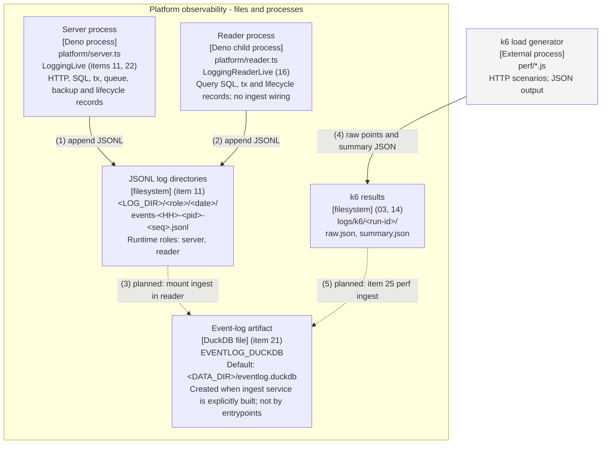

# C4 Level 2 — Container: the platform's observability path

Renderings: [GitHub](c4-container-observability.github.md) ·
[terminal](c4-container-observability.terminal.md).

## What this shows

Both entrypoints write rotating JSONL today. The item-21 DuckDB ingest implementation exists, but the reader
entrypoint does not mount it. The solid event-log box represents the implemented storage format; its dashed
incoming arrows mark runtime integrations that are still planned. No `scripts/logs.ts` or
`platform/analysis/catalog.ts` exists in the audited tree. Items 30 and 35 are not represented as landed.

The request path is in [the companion diagram](c4-container-platform.github.md).

## Relationships

All arrows are listed here in both formats. The terminal uses this key instead of crossing lines.

| # | From                  | To                    | Relationship                                                                                                                                                                                                                                                                              |
| - | --------------------- | --------------------- | ----------------------------------------------------------------------------------------------------------------------------------------------------------------------------------------------------------------------------------------------------------------------------------------- |
| 1 | Server process        | JSONL log directories | `LoggingLive` feeds a dropping queue and batching fiber in `platform/logging/logger.ts`; `file_sink.ts` rotates files. It does not block a mutation.                                                                                                                                      |
| 2 | Reader process        | JSONL log directories | `LoggingReaderLive` writes a separate role/pid file. Reader stdout carries only JSON-lines RPC replies.                                                                                                                                                                                   |
| 3 | JSONL log directories | Event-log artifact    | **Planned runtime wiring.** `EventLogIngestLive` exists in `platform/eventlog/ingest.ts`, but `ReaderProcessLive` only mounts config and logging. When explicitly built, ingest stages complete JSONL lines, inserts typed events and updates offsets in one transaction. It skips `.gz`. |
| 4 | k6 load generator     | k6 results            | k6 writes `raw.json` and `summary.json`; the perf task creates the run directory. Scenarios live in `perf/`.                                                                                                                                                                              |
| 5 | k6 results            | Event-log artifact    | **Planned, item 25.** `perf/ingest_k6.ts` is absent. `k6_points` DDL exists, but there is no loader from these artifacts.                                                                                                                                                                 |

## Runtime notes

- `POST /admin/logs/ingest` reaches the reader stub and returns `IngestError` (500).
  `POST /admin/logs/analysis/:name` returns `UnknownAnalysisQuery` (404), after auth and input validation.
- `EventLogIngestLive` owns a persistent DuckDB instance separate from the per-app in-memory query instances.
  The server imports neither DuckDB implementation; `platform/layers.ts` uses type-only imports.
- Event tables are append-only; `_ingest_state` is mutable. Prefix hashes and offsets support append
  detection; rewritten files use event-id deduplication. Rejected lines go to `rejected.jsonl`.
- Logs roll by UTC date/hour or `LOG_MAX_FILE_BYTES` (64 MiB default). Supported sink roles include `restore`
  and `cli`, but the current restore script does not mount a logging layer.
- Item 24's `platform/logging/retention.ts` implements inventory, safe gzip/delete, dry-run reporting and a
  scoped daily fiber. **No entrypoint starts it.** Defaults are gzip after 7 days, retain 30 days and a 1 GiB
  cap, with today's directory protected. Ingest-before-gzip and offset pruning are not implemented.
- `scripts/duckdb/log-level-distribution.sql` reads JSONL offline. Other starter SQL files require an
  explicitly populated event log. The logs CLI and named analysis catalog remain absent.
- Re-ingest can reconstruct only events whose source JSONL is still retained; this is not an unlimited backup
  of an event log after retention removes or compresses its sources.
