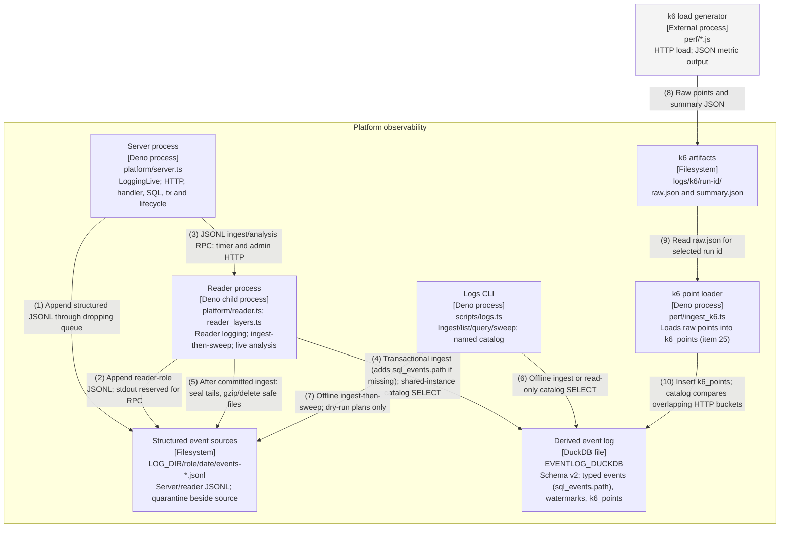

# Container — observability path

Audited against landed main `643b706` on 2026-10-11 (item 27); updated for FFI-06 at `5c2a499` on 2026-10-14.
Both formats are generated from `diagrams/c4-container-observability.py`; numbered relationships are
identical. All boxes describe landed code.

## Relationships

| #  | From              | To                       | Relationship                                                                           |
| -- | ----------------- | ------------------------ | -------------------------------------------------------------------------------------- |
| 1  | Server process    | Structured event sources | Append structured JSONL through dropping queue                                         |
| 2  | Reader process    | Structured event sources | Append reader-role JSONL; stdout reserved for RPC                                      |
| 3  | Server process    | Reader process           | JSONL ingest/analysis RPC; timer and admin HTTP                                        |
| 4  | Reader process    | Derived event log        | Transactional ingest (adds sql_events.path if missing); shared-instance catalog SELECT |
| 5  | Reader process    | Structured event sources | After committed ingest: seal tails, gzip/delete safe files                             |
| 6  | Logs CLI          | Derived event log        | Offline ingest or read-only catalog SELECT                                             |
| 7  | Logs CLI          | Structured event sources | Offline ingest-then-sweep; dry-run plans only                                          |
| 8  | k6 load generator | k6 artifacts             | Raw points and summary JSON                                                            |
| 9  | k6 artifacts      | k6 point loader          | Read raw.json for selected run id                                                      |
| 10 | k6 point loader   | Derived event log        | Insert k6_points; catalog compares overlapping HTTP buckets                            |

## Runtime notes

Item 23 provides the named catalog and logs CLI; item 25 provides the k6 loader and join acceptance test.
MT-10 wires the reader analysis RPC and shares the ingest instance so later commits remain visible. The server
never opens DuckDB. The standalone CLI queries read-only and can fail while a writer owns the file; use the
live admin route during serving. Ingest and analysis handles are independently scoped connections on the
shared native instance. Document reads run in-process against application SQLite files; they do not use the
reader event-log database. Retention bounds JSONL only, requires committed watermarks and matching hashes, and
never touches today or the reader sink open path. Derived tables are never pruned; logs:compact remains future
work. Gzipped retained sources are not re-ingested by the current scanner. No load-performance result is
claimed by this diagram. FFI-06: the sql event now persists its SQLite execution path (blocking or
nonblocking) in the JSONL line (core/events.ts KIND_KEYS) and in a nullable sql_events.path column
(core/eventlog/ddl.ts). Ingest runs ALTER TABLE sql_events ADD COLUMN IF NOT EXISTS path on every open, so an
older v2 file gains the column on its next ingest without a schema-version bump; older rows hold NULL. The
named catalog gains deadline-hits-per-handler-hour (platform/analysis/catalog.ts), which counts
StatementDeadlineError sql events by app, handler and UTC hour with the path; until an older log is
re-ingested, that one query fails on the missing column. The perf/ffi_*.ts harnesses and the deadline scenario
in tests/integration.ts add no container: the harnesses drive the FFI binding directly, and the scenario runs
the existing server, logs ingest and logs query.
