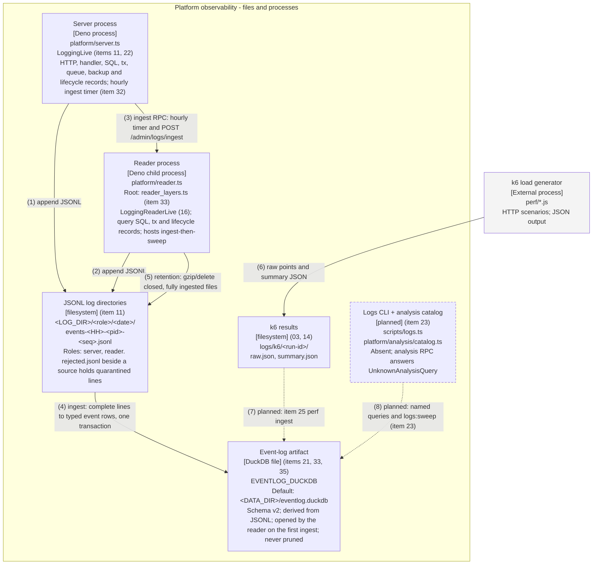

# C4 Level 2 — Container: the platform's observability path

Renderings: [GitHub](c4-container-observability.github.md) ·
[terminal](c4-container-observability.terminal.md).

## What this shows

Both entrypoints write rotating JSONL. The reader entrypoint mounts `EventLogIngestLive` through its own
composition root, `platform/reader_layers.ts` (item 33): the server asks it to ingest over the existing
`ingest` RPC, and the reader then sweeps retention over files that committed ingest fully covers (items 32,
36). The DuckDB event-log box is the derived store, not a source of truth. Dashed elements are not built: item
23's catalog and CLI (`scripts/logs.ts`, `platform/analysis/catalog.ts`) and item 25's k6 loader
(`perf/ingest_k6.ts`) are absent from the audited tree.

The request path is in [the companion diagram](c4-container-platform.github.md).



## Relationships

All arrows are listed here in both formats. The terminal uses this key instead of crossing lines.

| # | From                  | To                    | Relationship                                                                                                                                                                                                                                                                                                                                                                                                            |
| - | --------------------- | --------------------- | ----------------------------------------------------------------------------------------------------------------------------------------------------------------------------------------------------------------------------------------------------------------------------------------------------------------------------------------------------------------------------------------------------------------------- |
| 1 | Server process        | JSONL log directories | `LoggingLive` feeds a dropping queue and batching fiber in `platform/logging/logger.ts`; `file_sink.ts` rotates files. It does not block a mutation.                                                                                                                                                                                                                                                                    |
| 2 | Reader process        | JSONL log directories | `LoggingReaderLive` writes a separate role/pid file. Reader stdout carries only JSON-lines RPC replies.                                                                                                                                                                                                                                                                                                                 |
| 3 | Server process        | Reader process        | The existing `ingest` request over the JSON-lines RPC. A scoped fiber sends it every hour (first run one interval after start); `POST /admin/logs/ingest` sends it on demand. The server never opens DuckDB. The reply is an `IngestThenSweepReport`.                                                                                                                                                                   |
| 4 | JSONL log directories | Event-log artifact    | `EventLogIngestLive` (`platform/eventlog/ingest.ts`), mounted by `platform/reader_layers.ts`. Stages complete JSONL lines, inserts canonical and typed rows (each with `event_id`) and updates `_ingest_state` offsets in one transaction. Rejected lines are fsynced to `rejected.jsonl` first. It skips `.gz`. The handle opens on the first ingest; a failed open is a typed `IngestError` and is retried next time. |
| 5 | Reader process        | JSONL log directories | Retention runs only after a committed ingest, in the same RPC (ADR 0007): torn tails are sealed, then `retention.sweep` gzips or deletes files that are closed, settled and fully covered by committed watermarks. A file that fails the gate is pinned, kept and reported as blocked. The reader never touches a file its own sink holds open.                                                                         |
| 6 | k6 load generator     | k6 results            | k6 writes `raw.json` and `summary.json`; the perf task creates the run directory. Scenarios live in `perf/`.                                                                                                                                                                                                                                                                                                            |
| 7 | k6 results            | Event-log artifact    | **Planned, item 25.** `perf/ingest_k6.ts` is absent. `k6_points` DDL exists, but there is no loader from these artifacts.                                                                                                                                                                                                                                                                                               |
| 8 | Logs CLI + catalog    | Event-log artifact    | **Planned, item 23.** Named analysis queries and `logs:sweep`, which must call the same ingest-then-sweep coordinator (ADR 0007). `deno.json` declares the `logs:*` tasks, but `scripts/logs.ts` is absent, so they fail today.                                                                                                                                                                                         |

## Reader composition

The reader has its own composition root (`platform/reader_layers.ts`, item 33), kept apart from
`platform/layers.ts` so that the two processes never share a module graph (ADR 0001):

```text
acquire: Config -> reader Logging (sink + Logger) -> IdGen -> EventLogIngest   (event-log handle opens lazily)
release: EventLogIngest (connection, then instance) -> IdGen -> Logging (drain) -> Config
```

- `platform/reader.ts` serves one request at a time from stdin. `reader_context.ts` validates optional trace
  properties on each frame and annotates the request; invalid trace properties are ignored, a malformed frame
  ends the process.
- Per-app query readers come from `makeReaderPool` (`platform/duckdb.ts`): a separate in-memory DuckDB
  instance per app, opened lazily inside the program scope, which closes before the root. This is independent
  of the persistent event-log handle, so queries never depend on it.
- `ingest` answers with `ingestThenSweep()`: ingest, then sealing, then the sweep, then a budget measurement,
  under one ingest lock. No new RPC kind was added. The reader never sweeps a path its own sink holds open
  (`ownOpenLogPaths`); the server's open files are protected by the today/settle rules.
- `platform/layers.ts` has no runtime import of the ingest module. It declares only the type
  `ReaderProcessServices`. `tests/unit/reader_ingest_test.ts` walks both import graphs.
- A new reader-component (Level 3) diagram is deferred; this section and the container boxes carry it.

## Runtime notes

- `POST /admin/logs/analysis/:name` returns `UnknownAnalysisQuery` (404), after auth and input validation.
- `EventLogIngestLive` owns a persistent DuckDB instance separate from the per-app in-memory query instances.
  The file is the derived store: re-ingesting retained JSONL rebuilds it, and losing it loses nothing durable.
- Event tables are append-only; `_ingest_state` is mutable and its rows are never pruned (tombstones). Prefix
  hashes and offsets support append detection; rewritten files use event-id deduplication.
- Event schema v2 (item 35, ADR 0006): `event_id` on every typed row; `event_kind` (the record's kind) and
  `handler_kind`; backup rows carry `emitter`, `run_id` and `attempts`. A v1 or foreign file is refused by
  `EVENTLOG_DDL`'s guards. `upgradeEventLog` rebuilds v1 from retained JSONL; it is an operator step, and
  ingest never calls it.
- Logs roll by local date/hour or `LOG_MAX_FILE_BYTES` (64 MiB default). Supported sink roles include
  `restore` and `cli`, but the current restore script does not mount a logging layer.
- Budgets are reported separately. `LOG_MAX_TOTAL_BYTES` bounds the JSONL tree only, and even there today's
  files and pinned files may exceed it. The derived DuckDB file is measured, never capped or pruned.
- Gzipped files are never ingested, but only fully ingested files are ever gzipped. Re-ingest can reconstruct
  only events whose source JSONL is still retained; a retained `.gz` is not re-read.
- Trace ids reach the reader's `sql`, `tx` and log records through the RPC frame (item 34); the ingest timer
  runs outside any trace. k6 trace headers are not joined to platform events until item 25.
- `scripts/duckdb/log-level-distribution.sql` reads JSONL offline. Other starter SQL files require a populated
  event log. `docs/observability.md` and the logs CLI are item 23's and do not exist yet.
