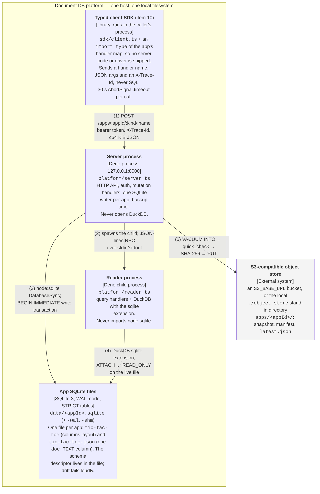

# C4 Level 2 — Container: the platform's request and backup path

GitHub/Mermaid rendering. The same diagram as box-drawing for a terminal:
[`c4-container-platform.terminal.md`](c4-container-platform.terminal.md).

The platform's logging and analysis containers are a second Level 2 diagram, so neither picture is cluttered:
[`c4-container-observability.github.md`](c4-container-observability.github.md).

## What this shows

The separately running things inside the platform boundary on the request path — two OS processes, the client
library, the app database files — and the one external store they talk to. Inside the server process is
expanded at [Level 3](c4-component-server.github.md).

Everything here exists on `main` today. The client SDK is already Effect-based (item 10); the two processes
are still the pre-port code, although `platform/ipc.ts` already frames the RPC stream with the pure decoder
from `core/ipc/framing.ts` (item 05). The Effect-TS port changes _what is inside_ the server and reader
processes (Level 3), not this container topology.

## Relationships

| # | From             | To                         | What travels over it                                                                                                                                                                                                                                                                                                                                                |
| - | ---------------- | -------------------------- | ------------------------------------------------------------------------------------------------------------------------------------------------------------------------------------------------------------------------------------------------------------------------------------------------------------------------------------------------------------------- |
| 1 | Typed client SDK | Server process             | `POST /apps/<appId>/<query\|mutation>/<name>`, `Authorization: Bearer <app token>`, JSON body capped at 64 KiB. `import type` keeps server handlers and database drivers out of the client bundle. Since item 10 every call carries an `X-Trace-Id` (caller-supplied or a fresh UUID); the server echoes it and annotates its events with it once item 22 lands.    |
| 2 | Server process   | Reader process             | The server spawns the reader at startup and pings it. Requests and replies are newline-delimited JSON over the child's stdin/stdout, correlated by request id, framed by the pure decoder in `core/ipc/framing.ts` (item 05). The reader's **stdout is reserved for this protocol** — its logs go to stderr today, and to its own log directory after plan item 16. |
| 3 | Server process   | App SQLite files           | `node:sqlite` `DatabaseSync`. One writer per app, serialized by a per-app queue; each mutation runs in one `BEGIN IMMEDIATE … COMMIT`, and the handler's own `db.get`/`db.find` calls execute inside that same transaction.                                                                                                                                         |
| 4 | Reader process   | App SQLite files           | DuckDB's `sqlite` extension, `ATTACH … (TYPE SQLITE, READ_ONLY)` against the **live** file — there is no second copy and no replication lag. Query handlers are serialized, one at a time, each in a fresh transaction.                                                                                                                                             |
| 5 | Server process   | S3-compatible object store | `VACUUM INTO` a temp snapshot (serialized with mutations) → `PRAGMA quick_check` → SHA-256 → PUT the immutable snapshot → PUT its manifest → only then PUT `latest.json`. The upload runs after the mutation queue is released. A failed upload never advances `latest.json`.                                                                                       |

## Why there are two processes

`platform/duckdb.ts` carries the load-bearing constraint: DuckDB's `sqlite` extension and Node's `node:sqlite`
are **two copies of the SQLite library**, and DuckDB documents a warning against linking both into one address
space. The OS-process boundary exists for exactly that reason, and Deno Workers are not a substitute for it.

Two invariants follow, and the plan's item 26 adds a test that greps for violations:

- the server process never imports `@duckdb/node-api`;
- the reader process never imports `node:sqlite`.

This is also why the planned DuckDB event log is ingested by the _reader_ process (see the observability
diagram) rather than written directly by the server.

## Containers deliberately left out

- **`scripts/restore.ts`** reads `latest.json` and the snapshot back from the object store, verifies the hash
  and integrity, and creates a **new** database file at a new path. It is an offline operation — the service
  must be stopped — so it is not part of the running topology. It is a container in its own right and belongs
  in this diagram if restore ever becomes an online path.
- **`scripts/demo.ts`** and **`scripts/explain.ts`** are developer tools, not runtime containers.
- **Logging, the DuckDB event log, k6 and the analysis CLI** are in the observability diagram.
