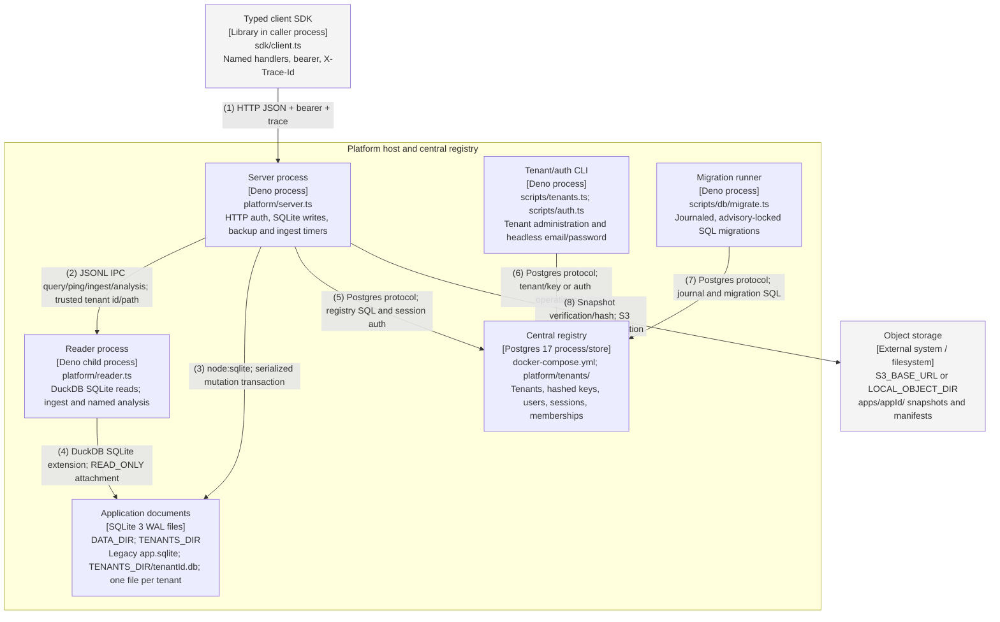

# Container — request path

Audited against landed main `643b706` on 2026-10-11 (item 27). Both formats are generated from
`diagrams/c4-container-platform.py`; numbered relationships are identical. All boxes describe landed code.

## Relationships

| # | From             | To                    | Relationship                                                 |
| - | ---------------- | --------------------- | ------------------------------------------------------------ |
| 1 | Typed client SDK | Server process        | HTTP JSON + bearer + trace                                   |
| 2 | Server process   | Reader process        | JSONL IPC query/ping/ingest/analysis; trusted tenant id/path |
| 3 | Server process   | Application documents | node:sqlite; serialized mutation transaction                 |
| 4 | Reader process   | Application documents | DuckDB SQLite extension; READ_ONLY attachment                |
| 5 | Server process   | Central registry      | Postgres protocol; registry SQL and session auth             |
| 6 | Tenant/auth CLI  | Central registry      | Postgres protocol; tenant/key or auth operations             |
| 7 | Migration runner | Central registry      | Postgres protocol; journal and migration SQL                 |
| 8 | Server process   | Object storage        | Snapshot verification/hash; S3 HTTPS or local publication    |

## Runtime notes

The writer and reader remain separate OS processes and native module graphs. The central Postgres connection
is acquired lazily for registry use; TENANCY=off preserves app tokens and legacy files. Each app has a
LocalFolderRouter over the shared TENANTS_DIR/tenantId.db path. Different physical layouts need distinct
tenants because the schema guard rejects switching layouts. Tenant-mode reads acquire a fresh scoped reader
per request; legacy reads use the app pool. Application documents stay in SQLite. Better Auth is mounted in
the server at /api/auth/*; scripts/auth.ts is the headless CLI. The future control-plane router is not
implemented. E2E uses ephemeral Postgres, distinct tenants for layouts, and fresh Better Auth servers per
layout.
