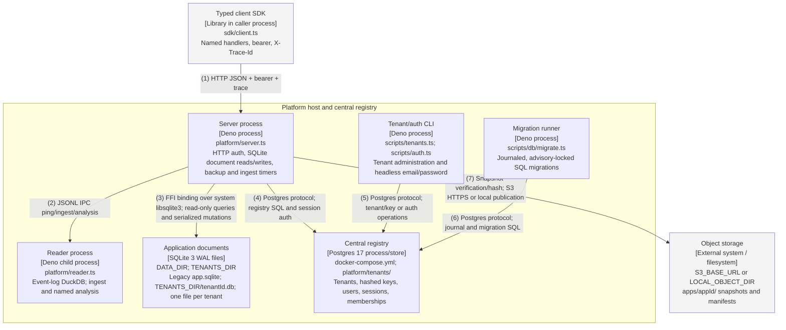

# Container — request path

Audited against landed main `643b706` on 2026-10-11 (item 27); re-checked for FFI-01 to FFI-05 at `f2bf1c9` on
2026-10-14, and re-audited at `aa26b27` (FFI-06 and FFI-07 change no element here; FFI-08 changes none). Both
formats are generated from `diagrams/c4-container-platform.py`; numbered relationships are identical. All
boxes describe landed code.

## Relationships

| # | From             | To                    | Relationship                                                                   |
| - | ---------------- | --------------------- | ------------------------------------------------------------------------------ |
| 1 | Typed client SDK | Server process        | HTTP JSON + bearer + trace                                                     |
| 2 | Server process   | Reader process        | JSONL IPC ping/ingest/analysis                                                 |
| 3 | Server process   | Application documents | FFI binding over system libsqlite3; read-only queries and serialized mutations |
| 4 | Server process   | Central registry      | Postgres protocol; registry SQL and session auth                               |
| 5 | Tenant/auth CLI  | Central registry      | Postgres protocol; tenant/key or auth operations                               |
| 6 | Migration runner | Central registry      | Postgres protocol; journal and migration SQL                                   |
| 7 | Server process   | Object storage        | Snapshot verification/hash; S3 HTTPS or local publication                      |

## Runtime notes

The writer and reader remain separate OS processes and native module graphs. The central Postgres connection
is acquired lazily for registry use; TENANCY=off preserves app tokens and legacy files. Each app has a
LocalFolderRouter over the shared TENANTS_DIR/tenantId.db path. Different physical layouts need distinct
tenants because the schema guard rejects switching layouts. Document queries use fresh read-only connections
in the server, opened through the FFI SQLite binding over system libsqlite3 (node:sqlite is no longer loaded),
with authenticated tenant routing selecting the file. Unbounded SQLite reads (any select that is not a
primary-key lookup, count, countBy) run nonblocking under a statement deadline (default 5 s) and fail HTTP 504
when it passes; writes and point reads stay blocking (FFI-05). The DuckDB SQLite extension stays in the
separate reader process, so the two SQLite copies never share an address space. Application documents stay in
SQLite. Better Auth is mounted in the server at /api/auth/*; scripts/auth.ts is the headless CLI. The future
control-plane router is not implemented. E2E uses ephemeral Postgres, distinct tenants for layouts, and fresh
Better Auth servers per layout.
