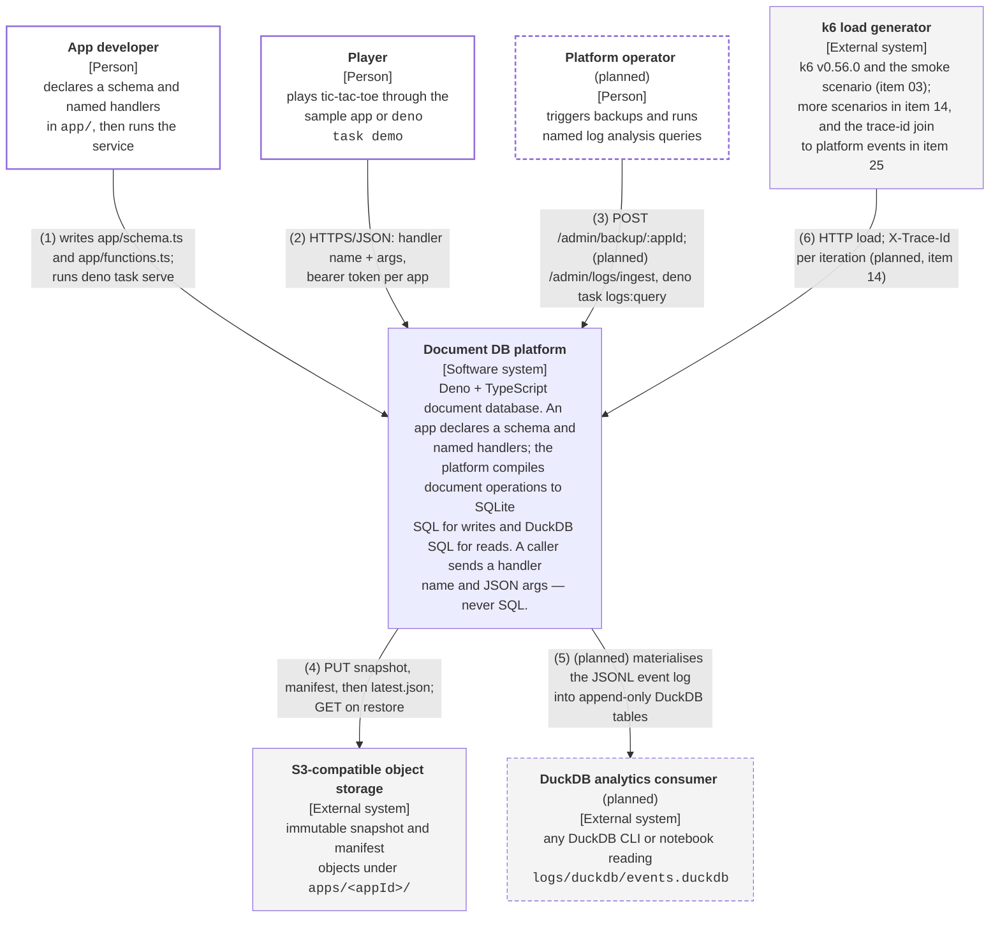

# C4 Level 1 — System Context: the Document DB platform

GitHub/Mermaid rendering. The same diagram as box-drawing for a terminal:
[`c4-context-document-db.terminal.md`](c4-context-document-db.terminal.md).

## What this shows

The platform as a single box, the people who use it, and the systems outside it. Everything inside the box is
expanded at [Level 2](c4-container-platform.github.md).

Elements drawn with a dashed border and labelled `(planned)` do not exist on `main` yet; they come from
[`docs/plans/effect-port-and-observability.md`](../plans/effect-port-and-observability.md).

## Relationships

| # | From                        | To                                  | What travels over it                                                                                                                                                                                                                                                        |
| - | --------------------------- | ----------------------------------- | --------------------------------------------------------------------------------------------------------------------------------------------------------------------------------------------------------------------------------------------------------------------------- |
| 1 | App developer               | Document DB platform                | Declares the schema in `app/schema.ts` and the handlers in `app/functions.ts`, then runs `deno task serve`. Handlers are statically registered modules — there is no code upload path.                                                                                      |
| 2 | Player                      | Document DB platform                | `POST /apps/<appId>/<query\|mutation>/<name>` with a JSON argument object and a per-app bearer token. Body cap 64 KiB. Never SQL.                                                                                                                                           |
| 3 | Platform operator (planned) | Document DB platform                | `POST /admin/backup/<appId>` with the admin token today; `POST /admin/logs/ingest` and `deno task logs:query <name>` once items 21–23 land.                                                                                                                                 |
| 4 | Document DB platform        | S3-compatible object storage        | `VACUUM INTO` snapshot → `PRAGMA quick_check` → SHA-256 → PUT the snapshot, PUT its manifest, and only then PUT `apps/<appId>/latest.json`. `scripts/restore.ts` reads the same objects back.                                                                               |
| 5 | Document DB platform        | DuckDB analytics consumer (planned) | The reader process ingests the rotating JSONL event log into `logs/duckdb/events.duckdb`; any DuckDB client can then read those append-only tables (plan item 21).                                                                                                          |
| 6 | k6 load generator           | Document DB platform                | Load scenarios against the same HTTP API. The k6 binary and `perf/smoke.js` landed with plan item 03; the mutation/query/mixed scenarios are item 14, and the `X-Trace-Id` per iteration that lets client-side latency join server-side event durations is items 14 and 25. |

## Notes on scope

- **The two demo apps are one deployment.** `tic-tac-toe` and `tic-tac-toe-json` run the same application code
  against independent database files; they are not separate systems and are not a tenant-isolation boundary.
- **There is no authenticated end-user identity.** The Player actor reaches the platform through an app-level
  shared bearer token; `playerId` is supplied by the caller, not verified. Row-level authorisation does not
  exist.
- **The local `./object-store/` directory is the default stand-in** for the S3 external system, so the whole
  snapshot/restore flow runs without a cloud account. It is not off-host redundancy.
- **Backup is asynchronous.** A successful mutation acknowledges a local SQLite commit, not S3 durability;
  losing the host loses commits newer than the last completed snapshot.
