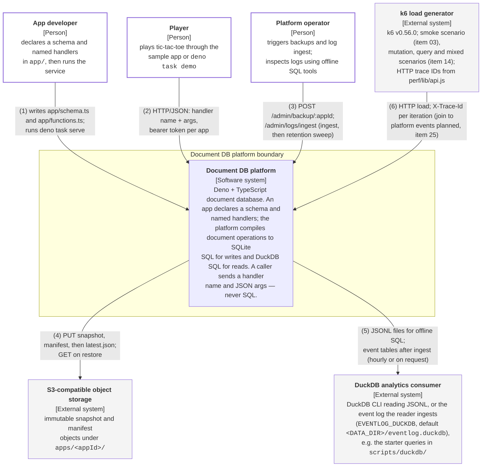

# C4 Level 1 — System Context: the Document DB platform

Renderings: [GitHub](c4-context-document-db.github.md) · [terminal](c4-context-document-db.terminal.md).

## What this shows

The platform as a single box, the people who use it, and the systems outside it. Everything inside the box is
expanded at [Level 2](c4-container-platform.github.md).

The actors and tools shown are available today. The operator can trigger backups and event-log ingest over
HTTP; the named analysis catalog and logs CLI (item 23) and the k6 loader (item 25) do not exist and are
called out in the relationship key.

## Relationships

| # | From                 | To                           | What travels over it                                                                                                                                                                                                                                                                                                                                                                                         |
| - | -------------------- | ---------------------------- | ------------------------------------------------------------------------------------------------------------------------------------------------------------------------------------------------------------------------------------------------------------------------------------------------------------------------------------------------------------------------------------------------------------ |
| 1 | App developer        | Document DB platform         | Declares the schema in `app/schema.ts` and the handlers in `app/functions.ts`, then runs `deno task serve`. Handlers are statically registered modules — there is no code upload path.                                                                                                                                                                                                                       |
| 2 | Player               | Document DB platform         | `POST /apps/<appId>/<query\|mutation>/<name>` with a JSON argument object and a per-app bearer token. Default body cap 64 KiB (configurable). Never SQL.                                                                                                                                                                                                                                                     |
| 3 | Platform operator    | Document DB platform         | `POST /admin/backup/<appId>` with the admin token. `POST /admin/logs/ingest` with the admin token runs the reader's ingest-then-sweep (the server also does it hourly). The analysis route returns `UnknownAnalysisQuery` (404); the logs CLI and catalog (item 23) are absent.                                                                                                                              |
| 4 | Document DB platform | S3-compatible object storage | `VACUUM INTO` snapshot → `PRAGMA quick_check` → SHA-256 → PUT the snapshot, PUT its manifest, and only then PUT `apps/<appId>/latest.json`. `scripts/restore.ts` reads the same objects back.                                                                                                                                                                                                                |
| 5 | Document DB platform | DuckDB analytics consumer    | Offline SQL in `scripts/duckdb/`: `log-level-distribution.sql` reads JSONL directly; the other queries need a populated event-log file. The running reader mounts `EventLogIngestLive` (item 33) and fills the derived event-log file, `EVENTLOG_DUCKDB`, default `<DATA_DIR>/eventlog.duckdb`, on each ingest.                                                                                              |
| 6 | k6 load generator    | Document DB platform         | Load scenarios against the same HTTP API. The k6 binary and `perf/smoke.js` landed with plan item 03; the mutation/query/mixed scenarios landed with item 14. The `X-Trace-Id` header is sent per iteration (`${__VU}-${__ITER}-${runId}`, via `perf/lib/api.js`) and the server records it on its events (item 34); loading k6 output into the event log to join client-side latency is planned in item 25. |

## Notes on scope

- **The two demo apps are one deployment.** `tic-tac-toe` and `tic-tac-toe-json` run the same application code
  against independent database files; they are not separate systems and are not a tenant-isolation boundary.
- **There is no authenticated end-user identity.** The Player actor reaches the platform through an app-level
  shared bearer token; `playerId` is supplied by the caller, not verified. Row-level authorisation does not
  exist.
- **The local `./object-store/` directory is the default stand-in** for the S3 external system, so the whole
  snapshot/restore flow runs without a cloud account. It is not off-host redundancy.
- **Backup is asynchronous.** A successful mutation acknowledges a local SQLite commit, not S3 durability;
  losing the host loses commits newer than the last completed snapshot.
