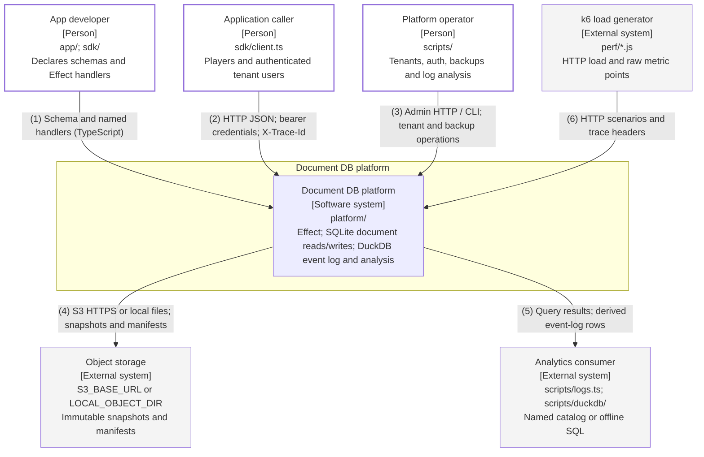

# System Context

Audited against landed main `643b706` on 2026-10-11 (item 27). Both formats are generated from
`diagrams/c4-context-document-db.py`; numbered relationships are identical. All boxes describe landed code.

## Relationships

| # | From                 | To                   | Relationship                                     |
| - | -------------------- | -------------------- | ------------------------------------------------ |
| 1 | App developer        | Document DB platform | Schema and named handlers (TypeScript)           |
| 2 | Application caller   | Document DB platform | HTTP JSON; bearer credentials; X-Trace-Id        |
| 3 | Platform operator    | Document DB platform | Admin HTTP / CLI; tenant and backup operations   |
| 4 | Document DB platform | Object storage       | S3 HTTPS or local files; snapshots and manifests |
| 5 | Document DB platform | Analytics consumer   | Query results; derived event-log rows            |
| 6 | k6 load generator    | Document DB platform | HTTP scenarios and trace headers                 |

## Runtime notes

Tenant identity comes from API keys or headless Better Auth session bearers when enabled. Postgres is part of
the platform, shown at Level 2; no external identity provider is wired. No application SQL crosses the client
boundary. This audit includes items 23, 25, 26 and MT-01 through MT-10.
