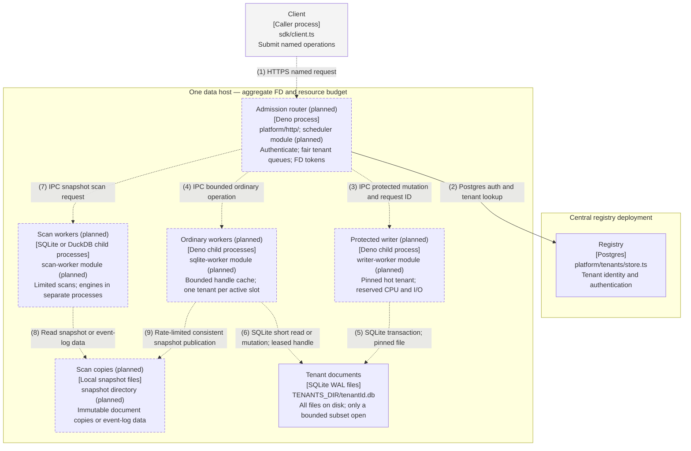
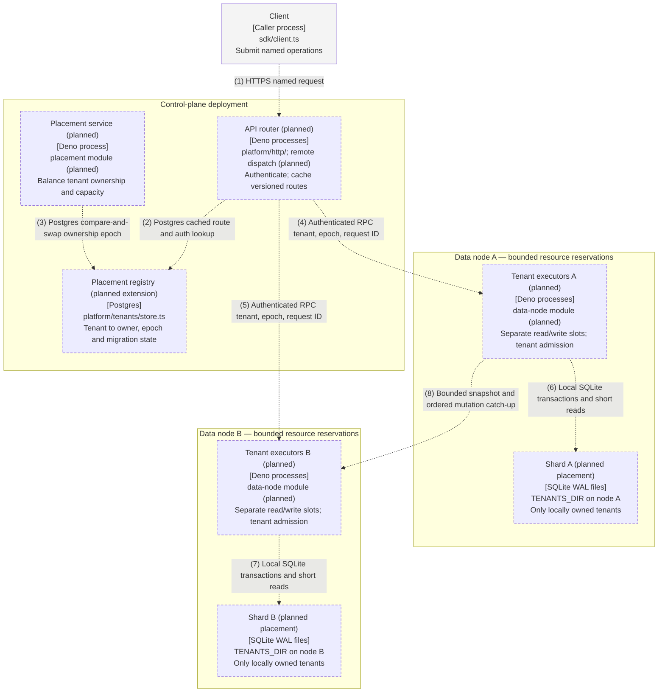
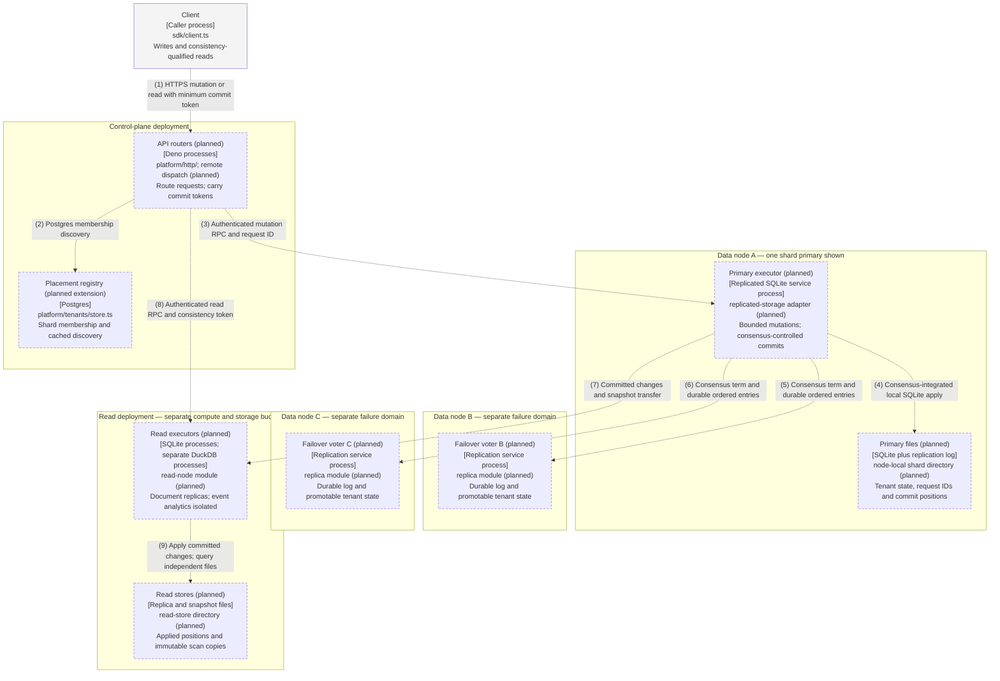
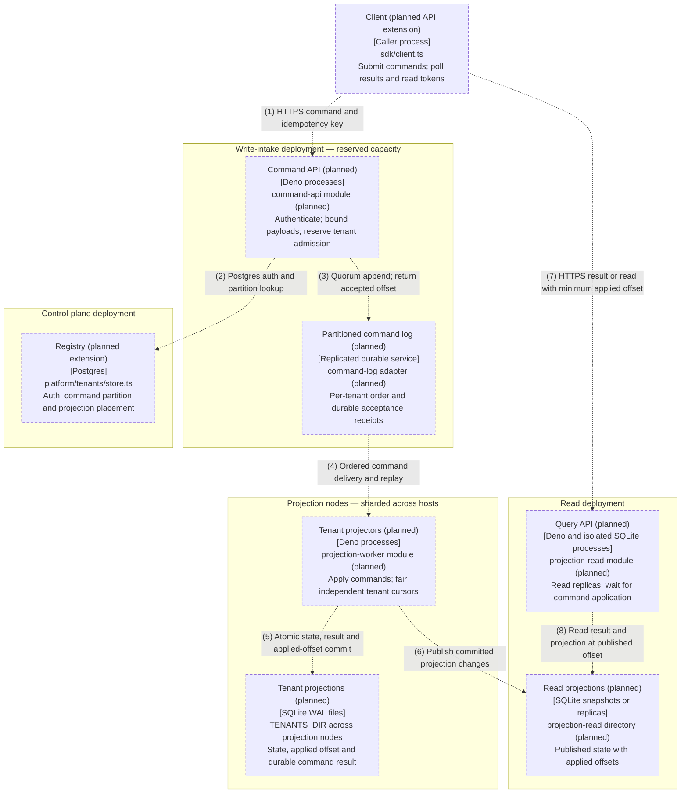

# Scale-out design approaches — Astra

Design exercise, 2026-10-11. Source baseline: `1031b06ed8520c33d0d5f496084268071de0b348` on
`arch/astra-scale-out`. These are independent proposals, not implemented architecture or a migration plan.

Revision, 2026-10-11: the independent pass remains at `c8ee93d`. This pass cross-checks its four approaches
against the supplied Convex/SurrealDB/Turso brief and primary sources. The recommendation and source baseline
above are unchanged. The brief is local, untracked reference material; the source links below keep this
revision readable without it. Vendor examples support techniques, not our proposed latency or failover
guarantees. Proposed mechanisms below remain unimplemented.

I would choose **capacity-aware tenant shards with replicated writers and separate read capacity (approach
3)**. Descriptor multiplexing belongs inside those shards. A new handle pool alone does not isolate
synchronous execution, and distributing files alone does not protect writes from analytical I/O.

## Baseline and the guarantee we can make

The source slightly refines the exercise's starting description. In
[platform/sqlite.ts](../../platform/sqlite.ts), `makeSingleStorage` owns one semaphore and synchronous SQLite
handle. Legacy app storage lives for the app scope. Tenant-mode `makeStorage` already caches leased tenant
storage instances: default capacity 64, 60-second idle expiry, and eviction only when unleased. Each instance
has its own writer semaphore. Opening, preparing, and closing entries run under a shared cache lock. Thus
tenant mode is not literally one writer semaphore or an unbounded set of permanently open files; it still
shares one server event loop and cache coordination path. Per-app caches also do not establish a node-wide FD
budget.

[platform/layers.ts](../../platform/layers.ts) composes the app stacks and one supervised reader child.
[platform/http/handlers.ts](../../platform/http/handlers.ts) sends tenant reads through that child today.
[platform/tenants/routing.ts](../../platform/tenants/routing.ts) returns a local path and synchronous open
capability; it does not yet route remote execution. These are useful seams, not distributed implementations.
All proposals assume the intended SQLite document-reader pivot; DuckDB remains a separate process for event
log ingest and analytics. No proposal loads both native engines into one process.

Three distinctions govern every approach:

- **FD capacity is node-wide.** More processes do not fix a host-wide descriptor ceiling. Count all SQLite
  connections, sidecars, worker IPC pipes, sockets, logs, backup and migration opens. Let `F` be the usable
  node budget, `R` the non-document reserve, and `d` a measured conservative peak FD cost per open document
  connection. Admission must enforce `d × active_connections + R <= F`, both per node and per process. The
  exact `d` is a measurement, not an assumption that one database equals one descriptor. If there are `C + 1`
  files for a node that can support only `C` open files, either leave some closed or place them on another
  node. Replicas and transient copies consume budget too.
- **The once-a-minute write is a workload, not a quiet window.** Never wait for a write-free minute to
  checkpoint, evict, transfer ownership, or elect a writer. Reserve a protected write lane continuously. Its
  contract must bound transaction size, execution time, arrival rate and burst size. A proposed acceptance
  target is a protected write completed within 5 seconds in healthy operation and within 30 seconds during a
  supported single-node failure; these are targets to validate, not measured claims.
- **Starvation freedom is not unconditional availability.** No finite system can guarantee every synchronous
  write under arbitrary overload, disk failure, or loss of every quorum. Safe failover also takes time.
  Interpret “never starved” as bounded service for admitted protected writes within a stated fault/capacity
  envelope; reject or defer ordinary work before it consumes that reservation. If it literally means no delay
  or failure under any failure whatsoever, none of these approaches satisfies it. Approach 4 can decouple
  durable acceptance from SQLite completion, but explicitly changes the API contract.

An isolated process is needed because `DatabaseSync` calls execute synchronously; adding Effect fibers or
per-tenant semaphores cannot preempt them. This follows the
[Node SQLite API](https://nodejs.org/api/sqlite.html), though the actual Deno compatibility implementation
must be benchmarked. CPU shares alone are insufficient: reserve CPU capacity, memory, IOPS, bandwidth and disk
space for protected writes, and cap tenant request and response sizes. Use per-tenant admission before
requests enter a shared queue. Do not put every tenant's logging behind one unbounded or blocking pipe.

SQLite WAL permits readers alongside a single writer, but old read transactions can hold back checkpoint
progress. Keep live-file reads short, expire old snapshots, and run long scans against separate copies. WAL
files cannot be shared between hosts using an ordinary network filesystem. These constraints come from
[SQLite's WAL documentation](https://www.sqlite.org/wal.html). A copying tool must use a consistent database
snapshot; naïvely copying a live `.db` plus sidecars is not a transfer protocol. Incremental online backup is
one possible primitive, with lock/restart behavior to account for, described by the
[SQLite backup API](https://www.sqlite.org/backup.html).

All diagrams below are C4 container-level target views. Subgraphs are deployment boundaries; a pool box
represents multiple processes, not fibers. New paths are explicitly marked planned. Planned boxes and
relationships are dashed. Only this requested Markdown file is produced: companion terminal diagrams and
architecture-index edits are outside this exercise's file scope.

## 1. One host, bounded descriptors, isolated execution lanes

### C4 diagram

| # | From             | To               | Relationship                                 |
| - | ---------------- | ---------------- | -------------------------------------------- |
| 1 | Client           | Admission router | HTTPS named request                          |
| 2 | Admission router | Registry         | Postgres auth and tenant lookup              |
| 3 | Admission router | Protected writer | IPC protected mutation and request ID        |
| 4 | Admission router | Ordinary workers | IPC bounded ordinary operation               |
| 5 | Protected writer | Tenant documents | SQLite transaction on pinned tenant file     |
| 6 | Ordinary workers | Tenant documents | Short read or mutation with a leased handle  |
| 7 | Admission router | Scan workers     | IPC scan request naming a snapshot           |
| 8 | Scan workers     | Scan copies      | Read independent snapshot or event-log data  |
| 9 | Ordinary workers | Scan copies      | Rate-limited consistent snapshot publication |

The router never executes document SQL. A tenant has at most one writer owner; ordinary workers must not write
the protected tenant's file. Other operations on that tenant enter its owner's bounded priority queue.
Protecting the hot tenant means pinning both a handle and execution/I/O capacity, not merely extending the
existing cache TTL beyond one minute. If any tenant can become hot without warning, reserve an activation slot
and specify its bounded cold-open latency; pinning an unspecified, unlimited hot set is impossible.

### Handling the three constraints

1. **FD exhaustion:** Acquire node-wide tokens before opening any connection, including reads, snapshots and
   temporary initialization handles. LRU eviction selects only idle, unleased entries. Closing a handle
   finishes before its token is reused. Reserve tokens for the protected writer and its recovery. There is no
   open-all startup or migration scan. At `C + 1` files, cold traffic cycles through fewer than `C`
   connections; startup succeeds even if every tenant is registered. Cache churn hurts cold latency, not
   correctness. If all ordinary handles are leased, queue within a bound or reject ordinary requests.
2. **Hot write every minute:** Its worker is never borrowed for reads and its FD reservation never expires.
   Bound each ordinary transaction ahead of it, cap bulk work, and reserve a dispatch slot for protected
   writes. Bulk APIs can split work only where their atomicity contract permits; otherwise oversized work is
   rejected. Checkpoint and backup scheduling runs under an I/O budget, never a global writer mutex. A worker
   restart uses its reserved recovery slot and idempotency lookup. A host failure stops this design: it has no
   failover guarantee and therefore does not meet a strict node-loss requirement.
3. **Noisy neighbors:** Run one tenant's active job per worker; cap its worker concurrency, CPU, memory and
   I/O. A supervisor outside the synchronous worker enforces deadlines, replacing a stuck worker after
   termination and resource cleanup. A timed-out write has an unknown result until its durable request ID is
   checked; do not blindly replay it. Keep other tenant slots available. Heavy scans use copies and limited
   resources; if storage cannot enforce I/O isolation, this approach fails the strong isolation requirement
   and needs a second host/device.

### Tradeoffs

Lowest distributed-systems complexity, no network hop for document execution, and normal SQLite transaction
semantics. Costs include IPC, process memory, repeated opens/schema checks, per-tenant scheduling, and host
I/O controls. Closing a last connection can itself perform work, so eviction must not run on the API event
loop or hold a global cache lock across cleanup. Snapshot scans are explicitly stale. Fresh, long reads are
rejected or converted to asynchronous snapshot jobs. No transparent host recovery; adding processes does not
add disk bandwidth or remove the shared host failure domain.

### Research cross-check

Turso's database-per-tenant model supports multiplexing a large population of mostly dormant files. The
brief's 10k+ databases per account and hundreds per node describe different scopes; neither establishes how
many connections this Deno host can safely keep open. Keep the measured FD formula and cold-open test. Its
many-database model also challenges any interpretation of this proposal as one permanent process per tenant:
only the protected working set is pinned; ordinary workers are pooled.

For hot-file backups, evaluate the brief's bottomless pattern: archive ordered WAL frames to object storage
between consistent base snapshots. Retain the snapshot and every required frame until a newer restore point is
durable; a restore drill must verify continuity. This augments approach 1's local scan copies and approach 2's
recovery path, without turning backups into promotable replicas.

Borrow the brief's cross-database upload batching only for the backup lane: flush on a bounded timer or byte
limit, retain per-tenant sequence ranges, checksums and restore manifests, and cap each tenant's contribution.
This amortizes object-store requests, not SQLite descriptors or transaction commits. Do not wait for a batch
to fill before serving a protected write. If upload is asynchronous, expose the durable backup watermark and
recovery-point gap; if upload gates acknowledgement, include its bounded delay and outage in the write SLO.
The brief's single-digit-millisecond claim is not a budget measured for this implementation.

### When I would pick it

Many mostly dormant tenants, one bounded hot working set, and no requirement to survive host loss. It is a
credible first step beyond the existing cache, but not my final choice when failover is part of constraint 2.

## 2. Capacity-aware tenant shards with local read/write pools

### C4 diagram

| # | From               | To                 | Relationship                                            |
| - | ------------------ | ------------------ | ------------------------------------------------------- |
| 1 | Client             | API router         | HTTPS named request                                     |
| 2 | API router         | Placement registry | Postgres route and auth lookup, with bounded caches     |
| 3 | Placement service  | Placement registry | Compare-and-swap ownership epoch and migration state    |
| 4 | API router         | Tenant executors A | Authenticated RPC carrying tenant, epoch and request ID |
| 5 | API router         | Tenant executors B | Authenticated RPC carrying tenant, epoch and request ID |
| 6 | Tenant executors A | Shard A            | Local SQLite transactions and short reads               |
| 7 | Tenant executors B | Shard B            | Local SQLite transactions and short reads               |
| 8 | Tenant executors A | Tenant executors B | Consistent snapshot and ordered mutation catch-up       |

Use virtual shards for placement, with explicit tenant overrides for hot tenants. Hashing proposes a home;
Postgres records the actual owner and epoch. Changing a hash-ring membership never implicitly transfers write
authority. Balance FD pressure, CPU time, bytes and IOPS, not just file count. All hosts keep bounded handle
caches and the process isolation of approach 1. The diagram abbreviates each node's local pools; analytics
follows approach 1's separate-copy policy and resource budget.

### Handling the three constraints

1. **FD exhaustion:** Place the extra file on B, or keep it cold in a bounded cache; no router or data node
   opens all files. Reserve node-wide tokens for each pool plus movement/recovery. Admission rejects a
   placement that exceeds limits even if hashing suggests that node. Destination capacity is reserved before
   copying; metadata listing tenants does not open their files. Two nodes are sufficient only if their actual
   budgets cover all active connections and headroom.
2. **Hot write every minute:** Each node reserves writer slots and I/O separately from readers. Hot tenants
   can own a process or node; bulk tenants cannot fill the protected lane. For a planned move, keep A
   authoritative while B receives a consistent snapshot and durable ordered changes recorded atomically with
   document mutations. This change stream is new work; the observability log is not suitable. Cut over only
   after catch-up fits the bounded pause budget: drain the current bounded transaction, durably fence A,
   install the final sequence on B, then publish a new epoch. Queue protected requests during this bounded
   barrier. Abort a move before fencing if catch-up cannot keep pace; writes continue on A. Do not wait for a
   quiet minute. A crashed owner still needs restore/recovery: without replicas, this design cannot promise
   the node-loss target.
3. **Noisy neighbors:** Per-node read and write pools have per-tenant admission and non-borrowable protected
   slots. One synchronous call occupies only its worker, not the router or all node workers. Resource caps
   prevent a burst from consuming shared disks; dedicate a device/node where enforceable disk reservations are
   unavailable. Long reads run on copies. Moving a hot tenant is an optimization, not the first line of
   defense: throttling and isolation must already work before the move finishes.

### Tradeoffs

A network round trip, deployment and routing complexity, and tenant-local transactions only. A remote
execution API is required: today's `StorageLocation.open()` cannot be serialized into an RPC. Routers forward
validated handler name, args, tenant identity, code/schema version, trace and idempotency ID over an
authenticated internal channel; data nodes recheck authorization scope and ownership. Never trust a
client-supplied file path or owner address.

Cached routing keeps Postgres off most data requests. Expired auth or ambiguous ownership must fail closed; a
control-plane outage is not permission to invent a new owner. A metadata epoch alone cannot fence a live old
SQLite writer: A must persist its handoff and cease writes before B starts, or infrastructure must positively
isolate A. If that cannot be established, the tenant stops safely. Placement and hot-tenant exceptions need
operational tooling. Backups provide disaster recovery, not automatic low-latency failover.

### Research cross-check

The brief's Turso control/data-plane split confirms the placement boundary; its Convex router pattern adds an
explicit operation and consistency contract. Mutations go to the current owner. Here, authoritative short
reads also go to that owner; snapshot reads require an explicit stale-read choice. Carry the last successful
write's tenant-scoped commit token across router instances and ownership moves. In approach 3, route reads to
replicas only after they meet that token. Session affinity improves cache locality but cannot prove freshness.
Tokens need a database incarnation and committed position, with a validated continuity rule across handoff;
wall-clock timestamps or a new placement epoch alone do not prove that earlier writes were applied.

Keep local and remote executors behind one operation interface, with deadlines, cancellation, authorization
and unknown-write outcomes specified at that boundary. Convex's shipped
[Funrun split](https://stack.convex.dev/horizontally-scaling-functions) separates read-only function execution
from backend commit validation over gRPC. It supports moving compute without moving write authority; it does
not prove that our arbitrary handlers are safe to execute speculatively. The brief's specific
Primary/Replica/RemoteCommitter topology is treated as a design reference, not a verified deployed contract.
Neither its roughly 5k mutations/sec guidance nor another service's tenant count sets our sharding threshold:
use measured queue latency, FD pressure and I/O saturation. Hot-tenant overrides remain capacity decisions.

### When I would pick it

Aggregate load exceeds one host, individual tenants fit one SQLite writer, and occasional tenant downtime on
host failure is acceptable. It is the cleanest scale-out foundation and a useful precursor to approach 3.

## 3. Replicated tenant shards with isolated read replicas

### C4 diagram

| # | From             | To                 | Relationship                                                   |
| - | ---------------- | ------------------ | -------------------------------------------------------------- |
| 1 | Client           | API routers        | HTTPS mutation or read carrying minimum commit token           |
| 2 | API routers      | Placement registry | Postgres membership discovery                                  |
| 3 | API routers      | Primary executor   | Authenticated mutation RPC and durable request ID              |
| 4 | Primary executor | Primary files      | SQLite application integrated with committed replication order |
| 5 | Primary executor | Failover voter B   | Consensus messages and durable ordered entries                 |
| 6 | Primary executor | Failover voter C   | Consensus messages and durable ordered entries                 |
| 7 | Primary executor | Read executors     | Committed changes and snapshots, asynchronously                |
| 8 | API routers      | Read executors     | Read RPC with consistency token                                |
| 9 | Read executors   | Read stores        | Apply changes and read local replicas or snapshots             |

This is approach 2 with a materially stronger storage contract, not “copy the WAL occasionally.” Each virtual
shard has three voters distributed across failure domains; different shards have different primaries. The
diagram shows one group. Shards contain bounded tenant sets, not every tenant in the system. Use a replication
service with specified, tested SQLite commit/consensus integration. Selecting and validating that service is a
prerequisite; plain `node:sqlite` plus Postgres leases does not supply it.

Successful mutation response means a durable quorum has accepted the transaction and the primary has applied
it with its request ID and result. Replicas must reproduce concrete state changes or deterministic execution
with captured IDs/time and matching code versions; arbitrary handler side effects cannot be replayed. A
transaction that fails to become committed must not become visible as successful state. Consensus terms and
quorum membership govern authority, while Postgres provides discovery. An isolated former primary cannot
acknowledge a new successful write merely because it still has a local SQLite file.

### Handling the three constraints

1. **FD exhaustion:** Both primary and follower placement obey the node-wide formula. Voters multiplex cold
   tenant handles; durable shard logs do not require every SQLite file to be open. Three full replicas on
   three hosts would still fail if each host opened all `C + 1` files. Shard distribution plus bounded caches
   is mandatory, and read copies have their own admission limits. Reserve failover capacity for promoted hot
   handles and write CPU/I/O, not just disk space for replicas.
2. **Hot write every minute:** Separate reserved writer, replication and recovery capacity from read capacity.
   Keep hot failover state applied and ready; never run scans on the failover voters' reserved resources. With
   one failed node, a surviving quorum elects a leader and retries request IDs within the tested recovery
   budget. Add/remove replicas through the replication system's safe membership protocol, not a router-only
   reassignment. Planned leadership transfer drains at a bounded transaction boundary; replica copying yields
   to writes. Reads and read-replica lag cannot hold the quorum commit path. Losing quorum stops successful
   writes; claiming otherwise would sacrifice the specified commit guarantee.
3. **Noisy neighbors:** Separate read deployment removes analytical CPU and disk contention from the write
   quorum. Replication groups still need per-tenant process slots, fair proposal admission and bounded
   transactions: putting all tenants in one consensus executor recreates head-of-line blocking. Keep shard
   groups small, isolate known hot tenants, and enforce resource reservations on every voter. Apply-lag bounds
   prevent one burst from exhausting the replication log disk. Degrade that tenant's bulk admission before
   consuming the protected write reserve.

### Tradeoffs

Highest storage engineering burden of the synchronous alternatives, quorum latency and at least three failure
domains for single-node quorum survival. Data, logs and spare capacity cost more than a single primary. The
exact replication mechanism is an unresolved dependency, not an existing repository feature.

Read replicas introduce explicit consistency choices. Default interactive reads should preserve the intended
API semantics: request a leader-certified read barrier and wait until the chosen replica has applied that
position before opening its SQLite read transaction. A write response token alone gives read-your-writes, not
an arbitrary linearizable read. Offer bounded-stale replica/snapshot reads only as an explicit API option. A
replica that misses its deadline returns a freshness error or reroutes to another qualified read replica;
never silently sends a large scan into the writer lane. A lagging learner may be dropped and resnapshotted
rather than retaining unbounded log history. Cross-tenant atomicity remains unsupported.

### Research cross-check

**Added mechanism: frame-log catch-up.** Prefer evaluating a libSQL-style physical frame stream for the
committed-change edges (7 and 9), rather than rerunning handlers or repeatedly copying whole hot files.
libSQL's
[WAL wrapper](https://github.com/tursodatabase/libsql/blob/main/libsql-server/src/replication/primary/replication_logger_wal.rs)
records page changes, handles rollback, and publishes a committed frame position. That is engine integration,
not a feature exposed by our existing `node:sqlite` adapter. The proposed adapter must couple this stream to
the quorum commit boundary before publishing frames as committed; the referenced implementation is not proof
of that stronger contract.

Bootstrap from a consistent snapshot labelled with its database incarnation and committed log position, then
replay a contiguous frame range. Apply complete transactions and publish an applied position only when readers
can see the whole commit. Detect gaps, generation changes and incompatible formats; discard divergent
uncommitted tails through the replication protocol. Retain catch-up history under a byte/time budget and
resnapshot a replica that falls behind it. Snapshot transfer and frame application consume the replica's FD,
memory and I/O budgets. Measure page-level write amplification before choosing physical replication over
concrete logical changes. This also provides a candidate for approach 2's planned-move catch-up stream.

**Confirmed and qualified: read-after-write.** Turso documents local reads, primary-forwarded writes and
[read-your-writes for embedded replicas](https://docs.turso.tech/features/embedded-replicas/introduction). The
guarantee applies to the initiating replica; other replicas need catch-up. For our routers, require the
selected replica's applied position to cover the response token before opening the read transaction. A
synchronized embedded replica is a useful read cache, not automatically an eligible failover voter.
Read-your-writes does not replace the leader-certified barrier for linearizable reads.

**Challenged: replication is not the failover protocol.** The brief's suggestion that per-file serial
semantics need no consensus overlooks ownership and acknowledged-write survival during node loss. One local
writer prevents local write races; it cannot elect its replacement or preserve an unreplicated success. Keep
the three-voter contract. Neither asynchronous frame shipping nor WAL-to-S3 backup by itself supplies it.
SurrealDB's multi-writer model from the brief is a contrast, not a reason to add concurrent writers to one
SQLite file or assume SQLite inherits distributed transactional visibility.

Turso also narrows my original implication that synchronous durability must always mean three full SQLite
copies: its [current storage description](https://turso.tech/what-is-turso) says acknowledgement follows WAL
persistence to S3 Express, with lazy segment fetching. That is distinct from the brief's libSQL/bottomless
model. A durable shared-log authority could be evaluated separately, but would still need fencing, recovery,
and availability proofs. It does not remove the three-voter dependency of the design chosen here.

### When I would pick it

Protected synchronous writes must survive one data-node failure, tenant count exceeds node FD capacity, and
analytical reads must not compete with writes. This is my choice for the strongest feasible reading of the
three constraints, provided replication and failure tests validate the promised service envelope.

## 4. Durable command intake with SQLite as an asynchronous projection

### C4 diagram

| # | From                    | To                      | Relationship                                           |
| - | ----------------------- | ----------------------- | ------------------------------------------------------ |
| 1 | Client                  | Command API             | HTTPS command and idempotency key                      |
| 2 | Command API             | Registry                | Postgres auth and command-partition lookup             |
| 3 | Command API             | Partitioned command log | Quorum append and durable acceptance offset            |
| 4 | Partitioned command log | Tenant projectors       | Ordered command delivery and replay                    |
| 5 | Tenant projectors       | Tenant projections      | Atomic state, command result and applied-offset commit |
| 6 | Tenant projectors       | Read projections        | Publish committed state and results                    |
| 7 | Client                  | Query API               | Result lookup or read requiring an applied offset      |
| 8 | Query API               | Read projections        | Read result and state at published offset              |

A mutation becomes `202 Accepted` with a receipt, followed by a committed result or a business-rule failure.
It is not the current synchronous mutation API. State-dependent validation happens at application time;
acceptance alone cannot promise that a conditional update will succeed. The event-observability pipeline
cannot act as this log: the new log is authoritative, durable, ordered and replayable.

### Handling the three constraints

1. **FD exhaustion:** Command intake opens no tenant SQLite files. Projectors lease a bounded working set
   across nodes; dormant projections remain closed. Log segments, consumers and network connections have their
   own bounded FD budgets. Do not create one open log file or broker connection per tenant. The protected
   tenant gets a resident projector; other tenants multiplex remaining descriptors.
2. **Hot write every minute:** Reserve append capacity and broker I/O for the protected command stream. SQLite
   failover and rebalance cannot stop durable acceptance while the log quorum remains available. Keep a
   separate reserved projector if the write must also become visible within a deadline. During projector
   migration, log intake continues; a new owner resumes from the durable applied offset after fencing the
   previous one. Admission requires remaining backlog capacity; provision and test a finite outage horizon.
   Unbounded projector outage eventually fills any log. Thus this approach protects acceptance, but does not
   satisfy the original synchronous-completion interpretation by itself.
3. **Noisy neighbors:** Schedule per-tenant cursors independently: one slow command must not stop a whole
   shared partition consumer from serving other tenants. Preserve order within each tenant, apply quotas
   before durable append, and maintain reserved projector workers. Separate read resources and cap export I/O.
   A tenant's oversized or failing command receives a durable failure result under a defined policy; never let
   a poison command wedge every tenant on its partition.

### Tradeoffs

Major API and storage-semantics change; additional consensus infrastructure, log retention, replay/versioning
and reconciliation tooling. The SQLite transaction stores command ID, result and applied offset atomically
with state. A crash after commit but before consumer acknowledgement then becomes a duplicate lookup, not
another mutation. External effects require a transactional outbox and idempotent delivery. Rebuilds require
versioned handlers or stable concrete events, captured nondeterminism, and snapshots before old log entries
are removed. Projection ownership fencing is still required: an intake log alone does not fence two projectors
writing divergent copies.

Command acceptance remains available during projection movement, but visible state lags. Clients use a receipt
to wait for application or explicitly accept stale reads. Backlog must drain faster than accepted traffic;
otherwise no completion bound exists even when append latency looks excellent.

### Research cross-check

Convex confirms the usefulness of an ordered transaction log, but challenges equating every log-backed system
with this approach's asynchronous command acceptance. Its
[commit protocol](https://stack.convex.dev/how-convex-works) validates a finalized transaction's read set,
appends its write set, and then returns the mutation result. Our existing semaphore serializes local writes;
it does not provide Convex's OCC validation or distributed durability. Likewise, libSQL frame logs encode
executed page changes, not pending application commands. A broker or WAL stream alone cannot validate a
conditional command before its SQLite projector runs.

Keep the receipt/result distinction explicit: rejection at intake differs from a durably accepted command that
later fails its condition. Persist that terminal result with the applied offset. Borrow ordered replay,
checkpointed snapshots and bounded retention, while preserving the stated asynchronous API change. A separate
backup consumer may batch uploads as in approach 1; it must not block the protected append or projector lanes.
None of the brief's examples establishes the finite outage horizon or backlog-drain bound this design needs.

### When I would pick it

Ingestion, jobs, telemetry or workflows where “durably accepted” is the useful write contract. I would not
quietly impose it on ts-db's existing interactive document mutations or sample application's conditional state
transitions. It is a deliberate product fork, not a transparent optimization.

## My choice and how I would validate it

**Choose approach 3, built on approach 2's routing and approach 1's bounded execution.** It is the only
synchronous alternative here that addresses all three constraints while tolerating one data-node failure. Keep
Postgres as the control plane, SQLite as tenant document storage, and DuckDB as isolated event analytics.
Adopt approach 4 only if users explicitly prefer durable asynchronous acceptance to immediate results.

| Approach             | More files than one node can open     | Protected write                              | Isolation boundary                         | Main limitation                          |
| -------------------- | ------------------------------------- | -------------------------------------------- | ------------------------------------------ | ---------------------------------------- |
| 1. Host multiplexing | Open only bounded working set         | Reserved local worker                        | Processes plus host resource reservations  | Host failure stops writes                |
| 2. Tenant shards     | Placement plus local caches           | Reserved owner capacity                      | Nodes and per-tenant worker slots          | Owner recovery without replication       |
| 3. Replicated shards | Placement and caches on every replica | Reserved quorum path and bounded failover    | Write voters separate from read deployment | Quorum required; replication integration |
| 4. Command log       | Intake independent of tenant FDs      | Durable acceptance independent of projection | Log, projectors and readers                | Acceptance is not document commit        |

The chosen guarantee assumes one failed data node, a reachable surviving quorum, healthy durable storage,
reserved replacement capacity, and bounded admitted workloads. It does not promise write success on both sides
of a partition. Postgres/auth availability is another dependency: provision it for the target SLO and specify
cache/credential expiry behavior rather than implying that data-node replication fixes it.

Concrete future changes would be scoped separately:

- [platform/http/handlers.ts](../../platform/http/handlers.ts) and
  [platform/layers.ts](../../platform/layers.ts): separate authentication/routing from data-node execution;
  build distinct process roots, bounded RPC and read-consistency handling.
- [platform/tenants/routing.ts](../../platform/tenants/routing.ts) and
  [platform/tenants/store.ts](../../platform/tenants/store.ts): add placement records and versioned remote
  destinations without weakening local path capabilities. Separate routing metadata from write authority.
- [platform/sqlite.ts](../../platform/sqlite.ts) and [platform/services.ts](../../platform/services.ts): move
  synchronous work out of the API process, replace cache-wide blocking lifecycle work, reserve node-wide FD
  tokens, and define durable request-result and replicated commit contracts.
- [platform/reader.ts](../../platform/reader.ts), [platform/ipc.ts](../../platform/ipc.ts), and
  [platform/duckdb.ts](../../platform/duckdb.ts): keep event analytics distinct from SQLite document readers;
  enforce real worker cancellation and per-tenant resource accounting instead of merely timing out callers.

Before calling the chosen design viable, I would require these experiments, with thresholds fixed before
running them:

1. **FD cliff:** Register exactly `C + 1` tenant files under an enforced node-wide budget. Drive adversarial
   cold-tenant rotation, concurrent snapshots, recovery and hot writes. Observe actual node/process peak
   descriptors and failed opens. Repeat with one node unavailable and replica promotion. No `EMFILE`, no
   all-files-open startup, and no protected-slot eviction are acceptable.
2. **Interference:** Run an unbounded-looking scan, write burst, large response and slow client for one tenant
   while independent tenants perform latency probes. Ensure admission bounds payloads before parsing or
   buffering can monopolize the router. Verify CPU, disk, memory and log limits as well as queue fairness.
   Complete the protected once-a-minute write within the proposed 5-second healthy target; ordinary tenants
   retain measurable service, not just a live health endpoint.
3. **Failure and movement:** Kill the primary before commit, after quorum commit, and after commit but before
   response. Retry the same ID; observe exactly one durable effect and stable result. Partition an old
   primary, then attempt writes through a stale router: no false success or divergent authority. Move a
   continuously written tenant and kill a participant during handoff. Surviving-quorum recovery must meet the
   proposed 30-second target; any missed target invalidates the availability claim.
4. **Read and storage pressure:** Delay replication, hold a scan snapshot, and approach WAL/log disk limits.
   Verify commit-token reads never return older state, scan cancellation releases actual resources, and stale
   learners are resnapshotted without filling the protected write volume. Reads must not turn into implicit
   synchronous dependencies of write acknowledgement.

5. **Frame-stream and backup recovery:** Interrupt replication inside a transaction, truncate retained
   history, reset a database incarnation and restore snapshot-plus-frames. Reject missing or mismatched
   history; expose no partial transaction and recover the same request results. Carry a write token through
   router replacement and primary movement; a lagging or unrelated replica must not satisfy it. Run one
   tenant's upload burst beside the protected write and measure batch delay, write amplification, backup
   watermark and restore time. If any object-store write gates acknowledgement, inject its outage explicitly.

These are design acceptance criteria, not tests executed in this documentation exercise. The current repo
supplies local storage, routing and supervision building blocks; it does not yet establish these distributed
guarantees. A replication integration that cannot pass them is a reason to revise the design, not relax the
meaning of a successful write.
