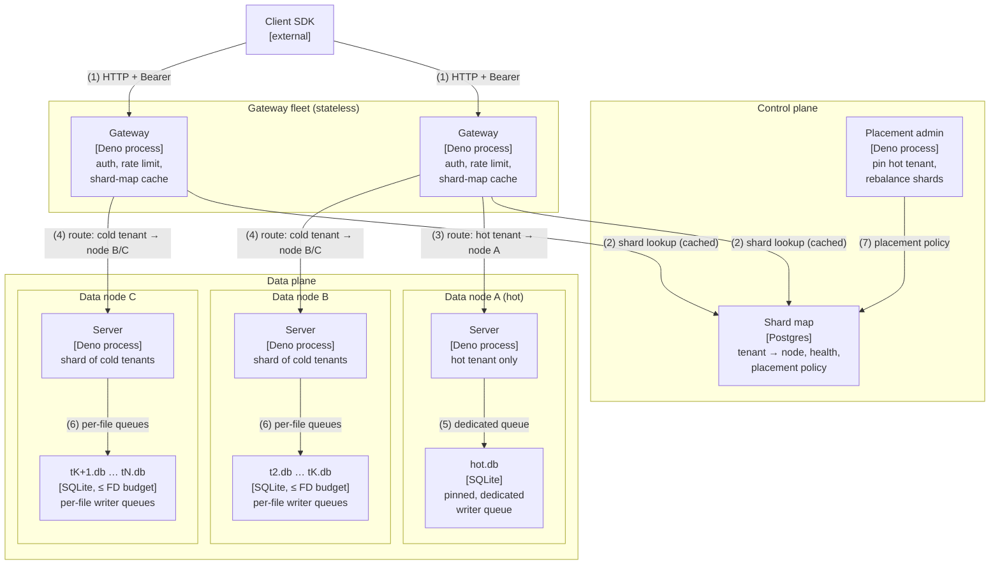
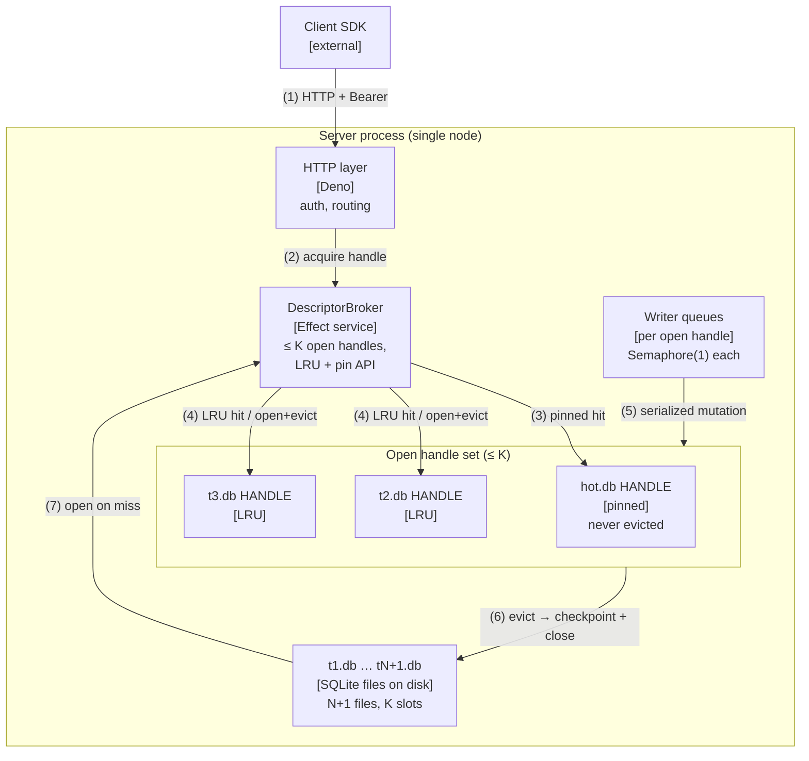
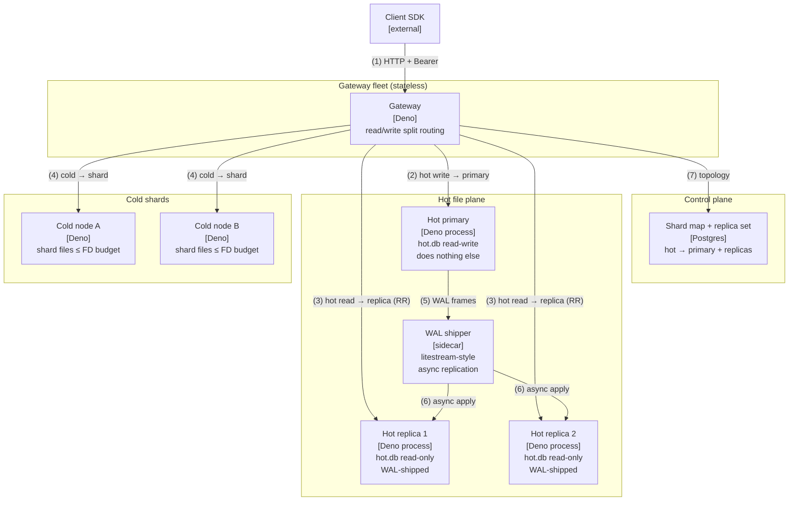
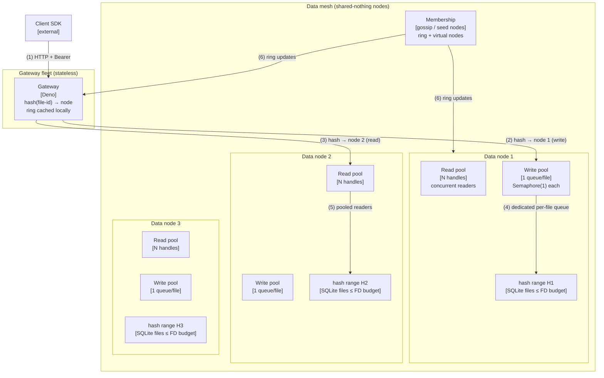
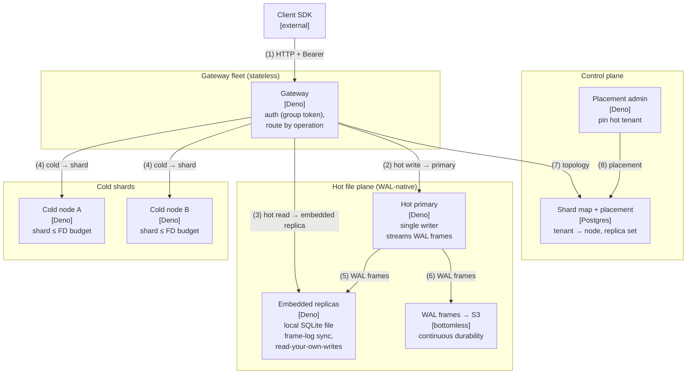

# Scale-out architectures: breaking the "one driver for n handles" contention

**Status:** design proposal (Opus, 2026-10-11). Not audited against landed code — these are
forward-looking architectures, not descriptions of the current system.

**The problem.** Today one server process holds every SQLite file handle and serializes work
through shared paths (one writer queue, one reader child). As file count grows, three things
collide: file-descriptor limits, write starvation, and noisy-neighbor contention.

**Hard constraints** (every approach below is designed against these):

1. **FD budget:** the platform has 1 more SQLite file than a single node can hold
   file-descriptor-wise. No design may open every file on one node.
2. **Hot write:** there is always a hot-path write every minute. The write path must never
   be starved.
3. **Isolation:** no single hot-path read or write may block everyone else.

**Shared vocabulary.** *Control plane* = routing, metadata, tenant→node mapping, health,
placement. *Data plane* = the nodes that actually open SQLite files and fulfill queries.
*Shard* = the set of files owned by one data node.

---

## Approach A — Control/data plane split with explicit shard placement

The operable default. A stateless gateway fleet fronts N data nodes. A control plane
(Postgres-backed, growing out of the existing tenant registry) holds an explicit
tenant→node shard map. Placement is operator-controlled: the hot tenant is pinned to a
dedicated node.

| # | From | To | Relationship |
| - | ---- | -- | ------------ |
| 1 | Client SDK | Gateway | HTTP + Bearer auth |
| 2 | Gateway | Shard map | Tenant→node lookup (locally cached, background refresh) |
| 3 | Gateway | Data node A | Hot tenant routed to dedicated node |
| 4 | Gateway | Data node B/C | Cold tenants routed by shard map |
| 5 | Server A | hot.db | Dedicated writer queue, pinned handle |
| 6 | Server B/C | shard files | Per-file writer queues, ≤ FD budget each |
| 7 | Placement admin | Shard map | Operator pinning and rebalancing |

**Constraints.**
1. *FD budget:* the shard map guarantees no node holds more files than its FD budget. N+1
   files ⇒ ≥2 nodes by construction; adding files adds nodes, never descriptors per node.
2. *Hot write:* the hot tenant owns node A outright. Its writer queue is never shared, so the
   every-minute write cannot be starved by any other tenant's workload.
3. *Isolation:* shard boundaries are isolation boundaries. Node A's tenants (just the hot one)
   never contend with node B/C. Cold tenants contend only within their shard.

**What breaks / gets hard.** The control plane is a new component to operate (though it grows
out of the existing Postgres registry). Shard-map lookups add a hop — cacheable, but cache
invalidation during rebalancing is the classic hard part. Cross-shard queries (analytics
spanning tenants) need a fan-out layer that doesn't exist yet. Rebalancing is
operator-driven; there is no automatic reaction to a newly-hot tenant until someone (or an
autoscaler) moves it.

**Pick when:** operability and determinism beat automation. Small team, tens to low hundreds
of tenants, and you want to be able to *prove* the hot tenant is isolated rather than hope a
hash function cooperates.

---

## Approach B — Single-node descriptor broker (LRU handle cache)

The "do you actually need multi-node yet?" option. Keep one server, but stop holding every
handle open. A `DescriptorBroker` owns at most K open SQLite handles (K ≤ FD budget) with LRU
eviction; the hot file is pinned and never evicted.

| # | From | To | Relationship |
| - | ---- | -- | ------------ |
| 1 | Client SDK | HTTP layer | HTTP + Bearer auth |
| 2 | HTTP layer | DescriptorBroker | Acquire handle for file |
| 3 | Broker | hot.db handle | Pinned — always resident |
| 4 | Broker | cold handles | LRU hit, or open (evicting LRU victim) |
| 5 | Writer queues | Open handles | One Semaphore(1) queue per open handle |
| 6 | Handles | Disk | Eviction checkpoints WAL and closes |
| 7 | Disk | Broker | Open on cache miss |

**Constraints.**
1. *FD budget:* hard cap K enforced by the broker — the process can never exceed it, no
   matter how many files exist. The N+1th file is served through open/evict cycles.
2. *Hot write:* the hot file is pinned. Its handle never closes and its writer queue never
   waits on descriptor availability, so the every-minute write is always servable.
3. *Isolation:* partial. The hot file is fully isolated (pinned). Cold files share K−1 slots:
   a bursty cold file can evict its neighbors and cause open/close churn. Mitigate with
   per-file open-rate limiting or second-chance eviction, but the contention is real.

**What breaks / gets hard.** This is a pressure valve, not a scaling story. If the *hot
working set* ever exceeds K, the cache thrashes and every query pays open+close — latency
collapses. Eviction must checkpoint WAL and close cleanly on every path (including
interrupts), which is correctness-critical code in the hottest loop. And one node remains a
single fate-sharing domain: a crash takes all files, not one shard.

**Pick when:** the files beyond the FD budget are genuinely cold; you need time before
committing to multi-node; the hot working set fits comfortably in K with headroom. Revisit
the moment the second file gets warm.

---

## Approach C — Hot-file primary/replica + sharded cold files

Give the hot path first-class treatment. The hot file gets a dedicated primary node (writes
+ local reads) and 1–2 async read replicas; cold files are sharded across follower nodes as
in Approach A.

| # | From | To | Relationship |
| - | ---- | -- | ------------ |
| 1 | Client SDK | Gateway | HTTP + Bearer auth |
| 2 | Gateway | Hot primary | All hot-file writes (dedicated) |
| 3 | Gateway | Hot replicas | Hot-file reads, round-robin |
| 4 | Gateway | Cold nodes | Cold tenants by shard map |
| 5 | Hot primary | WAL shipper | Async WAL frame shipping |
| 6 | WAL shipper | Replicas | Async apply (seconds of lag) |
| 7 | Gateway | Shard map | Topology: which node serves what |

**Constraints.**
1. *FD budget:* the hot file's 3 copies live on 3 nodes; cold files are sharded with per-node
   caps. No node exceeds its budget.
2. *Hot write:* the primary is physically dedicated — it serves one file and nothing else.
   The every-minute write cannot be starved because there is no shared queue at all.
3. *Isolation:* complete for the hot path. Hot reads never touch the primary (replicas absorb
   them); hot writes never touch cold nodes. Cold files are isolated by sharding.

**What breaks / gets hard.** Replication lag: replicas are async, so hot reads can be stale by
seconds — the product must tolerate it. SQLite has no native replication; you need WAL
shipping (litestream-style) or a logical outbox, both operationally real. Failover needs
promotion logic: if the primary dies, which replica takes over, and how do writers find it?
Split-brain during partitions is the nightmare scenario. And you pay 3× storage for the hot
file plus the shipping infrastructure.

**Pick when:** the hot file dominates traffic (the every-minute write plus heavy reads); a
few seconds of read staleness is acceptable; and you can staff replication and failover.
Composes well with Approach A — make the hot shard a primary/replica set when its read
volume earns it.

---

## Approach D — Consistent-hash data mesh with read/write pool separation

The automatic option. A stateless gateway fleet hashes file-id → data node on a consistent
hash ring (no Postgres lookup on the hot path). Each data node separates read and write
pools per file, so reads can never starve writes.

| # | From | To | Relationship |
| - | ---- | -- | ------------ |
| 1 | Client SDK | Gateway | HTTP + Bearer auth |
| 2 | Gateway | Write pool | Writes hashed to owning node, per-file queue |
| 3 | Gateway | Read pool | Reads hashed to owning node, pooled readers |
| 4 | Write pool | Files | One Semaphore(1) queue per file — writes never block on reads |
| 5 | Read pool | Files | Concurrent readers within the node's FD budget |
| 6 | Membership | All | Gossip propagates ring changes and node health |

**Constraints.**
1. *FD budget:* the ring spreads files across nodes; add nodes until per-node files ≤ budget.
   Virtual nodes keep the distribution even as nodes join/leave.
2. *Hot write:* read/write pool separation is the mechanism — the hot file's write queue is a
   different pool from its read pool, so the every-minute write never waits behind reads.
   Weighted fair queueing across per-file write queues prevents one file's write burst from
   starving another's.
3. *Isolation:* pool separation + per-file queues. A hot read cannot block the hot write
   (different pools); a hot file cannot block a cold file's writes (different queues). Hash
   collisions (two hot files landing on one node) are smoothed by virtual nodes and
   rebalancing.

**What breaks / gets hard.** This is the most complex to operate: membership, gossip,
rebalancing, and virtual-node tuning are a distributed system you now own. "Where is this
file?" requires consulting the ring, which makes debugging harder than an explicit map.
Rebalancing moves live files — you need online migration (copy + catch-up + cutover).
There is no operator override for placement; if the ring puts two hot files together, you
wait for the balancer rather than pinning them apart.

**Pick when:** automatic scaling matters more than operability; file count is large and
growing unpredictably; and the team can run a distributed system. This is the endgame
architecture, not the first step.

---

## Recommendation

**Pick Approach A** (control/data plane split with explicit shard placement).

It builds on seams that already exist in this codebase: the Postgres tenant registry
(MT-03), the `TenantStorageRouter` Effect tag (routing is already an interface, not a path),
and per-tenant SQLite files. The shard map is a natural extension of the registry, not a new
species of component. Explicit placement gives *deterministic* noisy-neighbor control — you
can prove the hot tenant is isolated, which matters more than theoretical throughput when
the constraint is "never block everyone."

Its honest limitation — operator-driven rebalancing — is acceptable at the scale where FD
limits first bite (tens of nodes, not thousands). When the hot file's read volume justifies
it, **refine with Approach C**: turn the hot shard into a primary/replica set without
changing the control-plane contract. Approach B is a legitimate stopgap if the over-budget
files are cold, and Approach D is where you go when manual placement stops scaling — but
neither should be the first step.

The through-line: keep the routing decision explicit and auditable for as long as you can.
Automatic placement is a tax you pay when the alternative — a human deciding where the hot
tenant lives — stops being fast enough.
---

## Research-informed revision (Opus, 2026-10-11)

**Status:** second pass. The four approaches above are preserved unmodified — what follows is
what the Convex / SurrealDB / Turso research changes. Research brief:
`/tmp/convex-surreal-research.md` (vm-1). The parallel Astra effort did its own
research-informed revision independently; this is mine.

**The research in one paragraph.** Turso is the existence proof that our architecture
(per-tenant SQLite files, control/data-plane split) works at production scale: 10,000+
databases per account, hundreds of SQLite DBs per node, single-writer with frame-log
replicas, WAL frames streamed continuously to S3 for durability. Convex's horizontal-scaling
plan independently converges on the same shape — one serial writer (their Committer, our
`Semaphore(1)`), primary/replica via a distributed log, a thin router splitting mutations
from queries — and adds a quantified threshold: don't distribute writes until ~5k
mutations/sec sustained; before that, pin hot tenants to dedicated shards. SurrealDB's
contribution is mostly negative space: quorum multi-write is heavier machinery than
per-file serial SQLite needs, but their compute/storage separation (TAPIR) is a legitimate
future direction.

### Per-approach revisions

**Approach A — strengthened, no structural change.** Turso validates the control/data-plane
split as a production pattern for SQLite-at-scale (their managed control plane vs
open-source libSQL data plane is exactly our Postgres-registry-plus-Deno-nodes shape).
Convex's hot-partition guidance ("dedicated shards for the biggest tenants" before 5k/sec)
independently confirms A's operator-pinned hot tenant. The research doesn't change A's
design; it changes A's status from "the operable default" to "the production-proven
default." One refinement worth stealing: Turso's group-token auth (one token spanning all
DBs in a group) for our Bearer scheme — a single API key authorizing across a tenant's
shards rather than per-node credentials.

**Approach B — strengthened as a stopgap, now with a concrete mechanism.** My original B
was hand-wavy about eviction correctness ("checkpoint WAL and close cleanly on every
path"). Turso's "hundreds of DBs per node" plus cross-database WAL batching (accumulate
frames from dozens of DBs over a few ms, upload in one S3 PUT) gives B a real
implementation story: the broker doesn't just evict, it batches durability across the open
set. This doesn't fix B's fundamental limits (single fate-sharing domain, thrash risk),
but it upgrades B from "pressure valve with scary eviction code" to "pressure valve with
a known-good batching pattern." Still a stopgap; still revisit when the second file gets
warm.

**Approach C — significantly strengthened; both flagged weaknesses dissolved.** My
original C had two weaknesses, and the research dissolves both:
1. *"SQLite has no native replication"* — Turso's frame-log replication (libSQL's WAL
   frame log pulled by replicas) is the concrete mechanism. Replace my vague
   "litestream-style WAL shipping" with frame-log replication: the primary streams WAL
   frames, replicas apply them. Production code, not a sidecar to build.
2. *"Replicas are async; hot reads can be stale by seconds"* — Turso's embedded replica
   pattern solves read-your-own-writes without quorum: the replica holds a local SQLite
   file and updates it on commit, so the writer's own reads are never stale. For other
   readers, Convex's router pattern (sticky sessions + write timestamps) bounds staleness
   deterministically.

C goes from "powerful but operationally scary" to "the hot path has a production
playbook." Failover/promotion remains the one genuinely hard part — but it's now the
*only* hard part rather than one of three.

**Approach D — weakened; prematurity now quantified.** Convex is explicit:
partitioned/distributed writes only become necessary past ~5k mutations/sec sustained. Our
hot path is one write per minute — roughly five orders of magnitude below that threshold.
D's distributed write machinery isn't just complex, it's solving a problem we don't have
and won't have for a very long time. D stays as the endgame, but the "consider D" trigger
moves from the vague "when manual placement stops scaling" to the measurable "when
sustained writes approach thousands per second."

### Approach E (new) — WAL-native control/data plane: the Turso playbook, composed

This is a **composition of A and C**, not a from-scratch design — labeled as such. Take
Approach A's control/data-plane split and shard map, and build Approach C's hot-file
replication in from day one using Turso's mechanisms:

- **Data plane:** per-tenant SQLite files on data nodes (A's sharding); the hot file gets
  a single-writer primary + frame-log replicas (C, upgraded via Turso).
- **Durability:** replace the snapshot→object-store backup flow with bottomless WAL-to-S3
  replication (TAPIR/Litestream lineage). Continuous frame streaming instead of periodic
  snapshots — cheaper, finer-grained recovery, no backup windows.
- **Reads:** hot reads go to embedded replicas (local file, zero network,
  read-your-own-writes on commit); cold reads go to shard nodes.
- **Control plane:** Postgres shard map + placement (A), with Turso-style group tokens
  for cross-shard auth.

| # | From | To | Relationship |
| - | ---- | -- | ------------ |
| 1 | Client SDK | Gateway | HTTP + Bearer (group token) |
| 2 | Gateway | Hot primary | All hot-file writes (single writer) |
| 3 | Gateway | Embedded replica | Hot reads, local file, zero network |
| 4 | Gateway | Cold nodes | Cold tenants by shard map |
| 5 | Hot primary | Embedded replicas | WAL frame-log replication |
| 6 | Hot primary | S3 | Bottomless WAL streaming (durability) |
| 7 | Gateway | Shard map | Topology lookup (cached) |
| 8 | Placement admin | Shard map | Operator pinning |

**Constraints.**
1. *FD budget:* the shard map caps per-node files (A); the hot file's replicas each hold
   one handle on separate nodes.
2. *Hot write:* single-writer primary, physically dedicated — the every-minute write
   cannot be starved.
3. *Isolation:* shard boundaries + replica separation; hot reads never touch the primary.

**What breaks / gets hard.** Frame-log replication needs a libSQL-style frame log or
equivalent — we're on stock SQLite via `node:sqlite`, so this is either a libSQL
migration or a custom WAL-frame shipper to build. Failover/promotion still needs design.
Bottomless WAL-to-S3 replaces the backup flow — a real migration of a load-bearing
system. More to build than plain A, but every mechanism is production-proven somewhere.

**Pick when:** you want A's operability with C's hot-path performance, and you're willing
to invest in WAL-native replication because the hot file earns it.

### Revised recommendation

**Pick Approach E** — which is to say: pick A, but build C's replication in from the
start using Turso's WAL-native mechanisms rather than deferring it.

The research changed my mind on one specific point. My original "refine with C when the
hot file's read volume earns it" assumed C's replication was speculative machinery worth
deferring. Turso proves the machinery exists and works — frame-log replication and
bottomless WAL are not research projects. Deferring them saves little and costs a
migration later. The honest cost of E over plain A is the WAL-frame infrastructure; the
honest benefit is that the hot path never needs a redesign.

What didn't change: A is still the foundation (the research validates it, it doesn't
replace it). B is still a stopgap (now with a better mechanism). D is still the endgame
(now with a quantified trigger: ~5k writes/sec sustained). SurrealDB's quorum consensus
remains correctly out of scope — per-file serial semantics don't need it, and the
research agrees.

The through-line from the original still holds — keep routing explicit and auditable —
with one addition from Turso: **make durability continuous (WAL streaming), not periodic
(snapshots).** The backup flow is the first thing I'd redesign under E.
