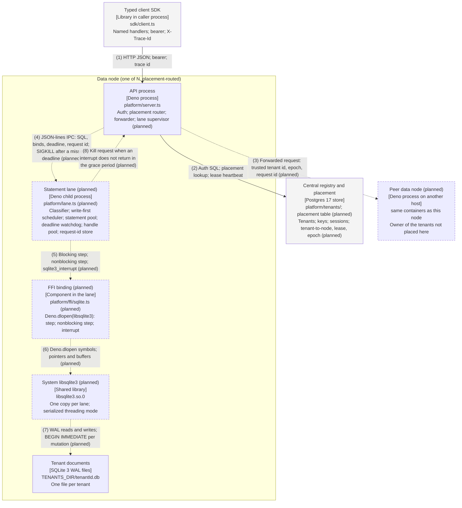

# FFI execution layer — architecture in Simplified Technical English

Status: proposed design, for study · Author: Fable 5.1 (with nickstrad) · Date: 2026-10-12 · Branch:
`docs/ffi-c4` · Baseline: `main` at `e808983`.

## About this document

This document describes the FFI execution layer in ASD-STE100 Simplified Technical English. It has the same
content as the C4 diagrams in this folder. The source material is the language-switch study
([lang-switch-fable.md](../../architecture/lang-switch-fable.md)) and the three C4 diagrams
([context](c4-context-ffi.github.md), [container](c4-container-ffi.github.md),
[component](c4-component-ffi-lane.github.md)).

The design is not landed. Each component marked **(planned)** does not exist on `main`.

The text follows these STE100 rules:

- Descriptive sentences have 25 words or fewer. Procedural sentences have 20 words or fewer.
- Each sentence gives one idea. Each sentence uses the active voice.
- Procedures use the imperative form with the component as the subject, in the order the steps occur.
- The same word always names the same thing.

These words are technical names in this document: API process, lane, statement, step, interrupt, deadline,
permit, handle, lease, epoch, request id, placement, tenant, WAL, FFI, IPC, SIGKILL. These words are technical
verbs: execute, commit, forward, interrupt, lease, spawn, bind, step.

## 1. Purpose of the system

The system is a document database. It keeps one SQLite file for each tenant. An API process receives HTTP
requests from a typed client. Named handlers in TypeScript do the reads and the writes.

Today the API process opens each tenant file itself through `node:sqlite`. This has two problems:

- A long statement blocks the event loop. No API call can stop it. The only remedy is to kill a child process.
- A kill of a child process stops every tenant on that process. The restart takes approximately 55 ms.

The FFI execution layer solves these problems. It moves statement execution into lanes. A lane loads the
system `libsqlite3` through Deno FFI. The FFI gives two functions that `node:sqlite` does not give:

- A nonblocking step. The step runs on a pool thread. The event loop stays live.
- `sqlite3_interrupt`. The main thread calls it. The statement stops in approximately 0.4 ms.

The design also adds placement. A central table says which node owns each tenant. A node forwards a request
for a tenant it does not own.

## 2. The components

### 2.1 API process

The API process is one Deno process on each data node. It exists today. The design adds three parts to it:

- The placement router. It finds the node that owns the tenant of a request.
- The forwarder. It sends a request to the owner node when the owner is a different node.
- The lane supervisor. It spawns the lanes, kills a lane on request, and starts a new lane in its place.

The API process does not open tenant files in the new design. It sends each statement to a lane over
JSON-lines IPC. The message holds the compiled SQL, the bind values, the deadline, and the request id.

### 2.2 Statement lanes (planned)

A lane is a child process of the API process. It has the same pattern as the DuckDB reader child. It uses
JSON-lines over stdio. The supervisor kills it and spawns it again.

Each tenant is sticky to one lane. The lane owns the tenant files of its tenants. A lane is the unit of
isolation for three things:

- A native crash in one lane does not stop the API process.
- Each lane has its own file-descriptor table.
- A kill of a lane stops only the statements on that lane.

A lane is not the cancellation mechanism. The interrupt inside the lane is the cancellation mechanism. A lane
has these internal components:

| Component             | Function                                                                                          |
| --------------------- | ------------------------------------------------------------------------------------------------- |
| IPC endpoint          | Receives statements, deadlines, cancels, and health checks. Sends results back.                   |
| Statement classifier  | Reads the plan shape. Sends a bounded plan to the synchronous path. Sends the rest to the pool.   |
| Write-first scheduler | Holds one writer lock per file. A mutation waits only for its own file, never for read permits.   |
| Statement pool        | Holds N permits for nonblocking steps. Applies a sub-cap for each tenant.                         |
| Deadline watchdog     | Holds one timer per statement. Calls the interrupt at the deadline. Asks for a kill if necessary. |
| Handle pool           | Holds one writer handle per file and a pool of read-only handles. Leases them. Evicts idle ones.  |
| Request-id store      | Writes the request id and the result inside the mutation transaction. Answers a retry from it.    |
| FFI binding           | Loads `libsqlite3` and gives the SQLite functions to the lane.                                    |

### 2.3 FFI binding (planned)

The FFI binding is one TypeScript module in each lane. It calls `Deno.dlopen` on the system `libsqlite3.so.0`.
It gives these functions: open, prepare, bind, step, nonblocking step, interrupt, finalize.

The step function has two forms:

- The blocking step runs on the main thread of the lane. A point read takes 6 to 7 µs. This is faster than
  `node:sqlite` today, at 9 µs. The blocking step cannot be interrupted.
- The nonblocking step runs on a pool thread. It gives a Promise. A call costs 44 to 69 µs. The interrupt can
  stop it.

The library runs in serialized threading mode. SQLite permits a call to `sqlite3_interrupt` from a different
thread.

### 2.4 Statement pool (planned)

The statement pool is a bounded pool for nonblocking steps. It has N permits for the lane. It also has a
sub-cap for each tenant. The sub-cap stops one tenant from taking all the permits.

When a tenant has used all of its sub-cap, the pool refuses the next statement of that tenant. The refusal is
a typed QueueFull error. Other tenants are not affected.

### 2.5 Deadline watchdog (planned)

The deadline watchdog keeps one timer for each nonblocking statement. The pool registers the deadline when it
leases a handle. At the deadline, the watchdog calls `sqlite3_interrupt(db)` from the main thread.

The watchdog then waits for a grace period. If the step does not return in the grace period, the watchdog asks
the supervisor to kill the lane. The kill is the last resort.

## 3. Architecture visual

The visual shows one data node and its neighbours. The two formats below show the same elements and the same
numbered edges. Solid boxes exist on `main`. Dashed boxes marked **(planned)** do not.

This visual is a summary of the Level 2 and Level 3 diagrams. It is kept by hand in this file. The script
`diagrams/render.py` does not generate it.

### 3.1 Mermaid (GitHub)



### 3.2 Box drawing (terminal)

Read this format in a terminal with `glow docs/plans/ffi/architecture-ste100.md`.

```text
╭╌ Data node (one of N, placement-routed) ╌╌╌╌╌╌╌╌╌╌╌╌╌╌╌╌╌╌╌╌╌╌╌╌╌╌╌╌╌╮
╎                                                                      ╎
╎  ┌──────────────────────────────┐   ┌┄┄┄┄┄┄┄┄┄┄┄┄┄┄┄┄┄┄┄┄┄┄┄┄┄┄┄┄┄┄┐ ╎
╎  │ API process                  │   ┆ Statement lane (planned)     ┆ ╎
╎  │ [Deno process]               │   ┆ [Deno child process]         ┆ ╎
╎  │ platform/server.ts           │   ┆ platform/lane.ts (planned)   ┆ ╎
╎  │ Auth; placement router;      │   ┆ Classifier; write-first      ┆ ╎
╎  │ forwarder; lane supervisor   │   ┆ scheduler; statement pool;   ┆ ╎
╎  │ (planned)                    │   ┆ deadline watchdog; handle    ┆ ╎
╎  └──────────────────────────────┘   ┆ pool; request-id store       ┆ ╎
╎                                     └┄┄┄┄┄┄┄┄┄┄┄┄┄┄┄┄┄┄┄┄┄┄┄┄┄┄┄┄┄┄┘ ╎
╎                                                                      ╎
╎  ┌┄┄┄┄┄┄┄┄┄┄┄┄┄┄┄┄┄┄┄┄┄┄┄┄┄┄┄┄┄┄┐   ┌┄┄┄┄┄┄┄┄┄┄┄┄┄┄┄┄┄┄┄┄┄┄┄┄┄┄┄┄┄┄┐ ╎
╎  ┆ FFI binding (planned)        ┆   ┆ System libsqlite3 (planned)  ┆ ╎
╎  ┆ [Component in the lane]      ┆   ┆ [Shared library]             ┆ ╎
╎  ┆ platform/ffi/sqlite.ts       ┆   ┆ libsqlite3.so.0              ┆ ╎
╎  ┆ (planned)                    ┆   ┆ One copy per lane;           ┆ ╎
╎  ┆ Deno.dlopen(libsqlite3):     ┆   ┆ serialized threading mode    ┆ ╎
╎  ┆ step; nonblocking step;      ┆   └┄┄┄┄┄┄┄┄┄┄┄┄┄┄┄┄┄┄┄┄┄┄┄┄┄┄┄┄┄┄┘ ╎
╎  ┆ interrupt                    ┆                                    ╎
╎  └┄┄┄┄┄┄┄┄┄┄┄┄┄┄┄┄┄┄┄┄┄┄┄┄┄┄┄┄┄┄┘                                    ╎
╎                                                                      ╎
╎  ┌──────────────────────────────┐                                    ╎
╎  │ Tenant documents             │                                    ╎
╎  │ [SQLite 3 WAL files]         │                                    ╎
╎  │ TENANTS_DIR/tenantId.db      │                                    ╎
╎  │ One file per tenant          │                                    ╎
╎  └──────────────────────────────┘                                    ╎
╎                                                                      ╎
╰╌╌╌╌╌╌╌╌╌╌╌╌╌╌╌╌╌╌╌╌╌╌╌╌╌╌╌╌╌╌╌╌╌╌╌╌╌╌╌╌╌╌╌╌╌╌╌╌╌╌╌╌╌╌╌╌╌╌╌╌╌╌╌╌╌╌╌╌╌╌╯

   ┌──────────────────────────────┐   ┌──────────────────────────────┐
   │ Typed client SDK             │   │ Central registry and         │
   │ [Library in caller process]  │   │ placement                    │
   │ sdk/client.ts                │   │ [Postgres 17 store]          │
   │ Named handlers; bearer;      │   │ platform/tenants/; placement │
   │ X-Trace-Id                   │   │ table (planned)              │
   └──────────────────────────────┘   │ Tenants; keys; sessions;     │
                                      │ tenant-to-node, lease, epoch │
                                      │ (planned)                    │
                                      └──────────────────────────────┘

   ┌┄┄┄┄┄┄┄┄┄┄┄┄┄┄┄┄┄┄┄┄┄┄┄┄┄┄┄┄┄┄┐
   ┆ Peer data node (planned)     ┆
   ┆ [Deno process on another     ┆
   ┆ host]                        ┆
   ┆ same containers as this node ┆
   ┆ Owner of the tenants not     ┆
   ┆ placed here                  ┆
   └┄┄┄┄┄┄┄┄┄┄┄┄┄┄┄┄┄┄┄┄┄┄┄┄┄┄┄┄┄┄┘
```

### 3.3 Relationships

| # | From                        | To                             | Relationship                                                                                |
| - | --------------------------- | ------------------------------ | ------------------------------------------------------------------------------------------- |
| 1 | Typed client SDK            | API process                    | HTTP JSON; bearer; trace id                                                                 |
| 2 | API process                 | Central registry and placement | Auth SQL; placement lookup; lease heartbeat                                                 |
| 3 | API process                 | Peer data node (planned)       | Forwarded request: trusted tenant id, epoch, request id (planned)                           |
| 4 | API process                 | Statement lane (planned)       | JSON-lines IPC: SQL, binds, deadline, request id; SIGKILL after a missed deadline (planned) |
| 5 | Statement lane (planned)    | FFI binding (planned)          | Blocking step; nonblocking step; sqlite3_interrupt (planned)                                |
| 6 | FFI binding (planned)       | System libsqlite3 (planned)    | Deno.dlopen symbols; pointers and buffers (planned)                                         |
| 7 | System libsqlite3 (planned) | Tenant documents               | WAL reads and writes; BEGIN IMMEDIATE per mutation (planned)                                |
| 8 | Statement lane (planned)    | API process                    | Kill request when an interrupt does not return in the grace period (planned)                |

## 4. How a point read works

A point read is an indexed lookup. It returns one row at most. Its plan is bounded. The edge numbers refer to
the visual in section 3.

1. The API process authenticates the request and resolves the tenant.
2. The placement router finds that this node owns the tenant.
3. The API process sends the SQL, the bind values, the deadline, and the request id to the lane (edge 4).
4. The classifier reads the plan. The plan is bounded. The classifier selects the synchronous path.
5. The scheduler leases a read-only handle for the tenant file from the handle pool.
6. The scheduler calls the blocking step on the main thread of the lane (edges 5, 6, 7).
7. The step returns the row in 6 to 7 µs.
8. The lane sends the result back over IPC (edge 4, in reverse).
9. The scheduler returns the handle to the handle pool.

The blocking step cannot be interrupted. For this reason, only a bounded plan can take the synchronous path.

## 5. How a long statement is interrupted

A long statement has an unbounded plan. Examples are a list query, an aggregate, and a query with a
user-controlled predicate.

1. The API process sends the statement to the lane (edge 4). The message holds the deadline.
2. The classifier reads the plan. The plan is unbounded. The classifier selects the nonblocking path.
3. The pool checks the sub-cap of the tenant and the permit count of the lane.
4. If the tenant has no permit left, the pool sends a typed QueueFull error. Stop here.
5. The pool leases a read-only handle from the handle pool.
6. The pool registers the deadline with the watchdog.
7. The pool calls the nonblocking step. The step runs on a pool thread (edges 5, 6, 7).
8. The main thread of the lane stays free. It continues to serve point reads and IPC.
9. If the step returns before the deadline, the lane sends the result back. Stop here.
10. At the deadline, the watchdog calls `sqlite3_interrupt(db)` from the main thread.
11. The step returns `SQLITE_INTERRUPT` in approximately 0.4 ms.
12. The lane sends a typed deadline error back to the API process.
13. If the step does not return in the grace period, the watchdog asks the supervisor for a kill (edge 8).

Step 13 is the last resort. Section 7 describes what happens next.

## 6. How placement routes a request

Placement is the scale-out pick F. A `placement` table in the central registry holds one row for each tenant.
The row holds the owner node, a lease, and an epoch. The epoch increases at each move.

1. Any node receives the request. It authenticates the request (edge 1).
2. The node derives the tenant from the credential. The client cannot select the tenant.
3. The placement router reads the owner from its cache. If the cache is empty, it reads the table (edge 2).
4. If this node owns the tenant, the API process sends the request to the lane of the tenant (edge 4). Stop
   here.
5. If a different node owns the tenant, the forwarder sends the request to that node (edge 3).
6. The forwarded request holds the trusted tenant id, the epoch, and the request id.
7. The owner node checks its lease and the epoch.
8. If the epoch is stale, the owner node answers WrongOwner.
9. The forwarder refreshes the placement one time and sends the request again.
10. If the epoch is valid, the owner node sends the request to the lane of the tenant.
11. For a mutation, the lane takes the writer lock of the tenant file only.
12. The lane writes the request id and the result inside the same transaction. It then commits.
13. If the forward times out, the forwarder sends the request again with the same request id.
14. The lane finds the request id in the request-id store. It answers from the store. It does not execute the
    mutation again.

The client contract does not change. The client sends each request to any node.

## 7. What happens when a lane stops

A lane stops for one of two reasons. The supervisor kills it after a missed deadline. Or the lane has a native
crash.

1. The watchdog asks the supervisor for a kill (edge 8). The supervisor sends SIGKILL to the lane (edge 4).
2. The lane process exits in approximately 4 ms.
3. Each statement in flight on that lane fails with a typed lane-restart error.
4. The API process does not execute a mutation in flight again without a check. It retries with the same
   request id. The new lane answers from the request-id store if the mutation did commit.
5. The supervisor spawns a new lane with the same set of tenants.
6. The new lane answers its first request approximately 51 ms after the spawn.
7. The other lanes, the API process, and the reader child continue to operate. The kill does not affect them.

The whole sequence takes approximately 55 ms. The measurement is in the language-switch study, section 3.1.

## 8. Measured values

All values are from the proof-of-concept runs on vm-1 on 2026-10-12. The raw data is in
[`lang-switch-fable-data/`](../../architecture/lang-switch-fable-data/).

| Measurement                                       |         Value |
| ------------------------------------------------- | ------------: |
| Point read, `node:sqlite` on the main thread, p50 | 8.7 to 8.9 µs |
| Point read, FFI blocking step, p50                | 6.3 to 6.8 µs |
| Point read, FFI nonblocking step, p50             |   44 to 69 µs |
| Interrupt latency, FFI nonblocking step           |       0.41 ms |
| Lane kill, SIGKILL to exit                        |        3.8 ms |
| Lane restart, spawn to first answer               |         51 ms |
| `Worker.terminate()` on a running statement       |        24.9 s |
| File descriptors, writer handle                   |             3 |
| File descriptors, read-only handle                |             2 |

## 9. Sources

- [lang-switch-fable.md](../../architecture/lang-switch-fable.md): measurements and the FFI recommendation.
- [scale-out-final-fable.md](../../architecture/scale-out-final-fable.md): placement, lanes, the write-first
  scheduler, and the request-id store.
- [README.md](README.md): the C4 diagram set and the key flows this document restates.
- [ASD-STE100](https://www.asd-ste100.org/): the Simplified Technical English specification.
