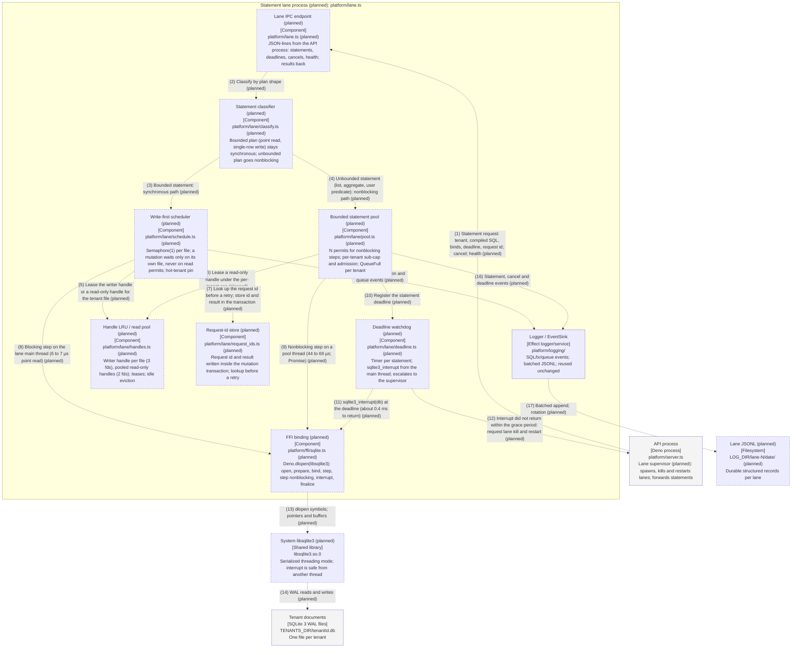

# Component — statement lane process (planned)

Proposed design, not landed code: the FFI execution layer from
[lang-switch-fable.md](../../architecture/lang-switch-fable.md) combined with the scale-out pick F from
[scale-out-final-fable.md](../../architecture/scale-out-final-fable.md). Baseline `main` at `e808983`
(2026-10-12). Solid boxes and solid edges exist on `main`; dashed boxes and dashed edges marked **(planned)**
do not. Both formats are generated from `diagrams/c4-component-ffi-lane.py`; numbered relationships are
identical.

## Relationships

| #  | From                             | To                               | Relationship                                                                                   |
| -- | -------------------------------- | -------------------------------- | ---------------------------------------------------------------------------------------------- |
| 1  | API process                      | Lane IPC endpoint (planned)      | Statement request: tenant, compiled SQL, binds, deadline, request id; cancel; health (planned) |
| 2  | Lane IPC endpoint (planned)      | Statement classifier (planned)   | Classify by plan shape (planned)                                                               |
| 3  | Statement classifier (planned)   | Write-first scheduler (planned)  | Bounded statement: synchronous path (planned)                                                  |
| 4  | Statement classifier (planned)   | Bounded statement pool (planned) | Unbounded statement (list, aggregate, user predicate): nonblocking path (planned)              |
| 5  | Write-first scheduler (planned)  | Handle LRU / read pool (planned) | Lease the writer handle or a read-only handle for the tenant file (planned)                    |
| 6  | Bounded statement pool (planned) | Handle LRU / read pool (planned) | Lease a read-only handle under the per-tenant cap (planned)                                    |
| 7  | Write-first scheduler (planned)  | Request-id store (planned)       | Look up the request id before a retry; store id and result in the transaction (planned)        |
| 8  | Write-first scheduler (planned)  | FFI binding (planned)            | Blocking step on the lane main thread (6 to 7 µs point read) (planned)                         |
| 9  | Bounded statement pool (planned) | FFI binding (planned)            | Nonblocking step on a pool thread (44 to 69 µs; Promise) (planned)                             |
| 10 | Bounded statement pool (planned) | Deadline watchdog (planned)      | Register the statement deadline (planned)                                                      |
| 11 | Deadline watchdog (planned)      | FFI binding (planned)            | sqlite3_interrupt(db) at the deadline (about 0.4 ms to return) (planned)                       |
| 12 | Deadline watchdog (planned)      | API process                      | Interrupt did not return within the grace period: request lane kill and restart (planned)      |
| 13 | FFI binding (planned)            | System libsqlite3 (planned)      | dlopen symbols; pointers and buffers (planned)                                                 |
| 14 | System libsqlite3 (planned)      | Tenant documents                 | WAL reads and writes (planned)                                                                 |
| 15 | Write-first scheduler (planned)  | Logger / EventSink               | SQL, transaction and queue events (planned)                                                    |
| 16 | Bounded statement pool (planned) | Logger / EventSink               | Statement, cancel and deadline events (planned)                                                |
| 17 | Logger / EventSink               | Lane JSONL (planned)             | Batched append; rotation (planned)                                                             |

## Runtime notes

Nothing inside this boundary exists on `main` except the logger, which is reused as-is. The lane is the
in-node half of scale-out pick F and the execution layer of the lang-switch study; the file paths are
proposals. The path a statement takes is decided once by the classifier (edge 2): a bounded plan runs
synchronously on the lane's main thread (edges 3, 8), which is faster than today's `node:sqlite` and cannot be
interrupted, so it is reserved for statements that cannot run long; everything else runs on a pool thread
(edges 4, 9) and is cancellable by `sqlite3_interrupt` from the main thread (edge 11), which SQLite documents
as safe from another thread. The watchdog escalates only when an interrupt does not return (edge 12), so a
SIGKILL remains the last resort and the whole lane restarts (about 55 ms measured). The write-first scheduler
keeps the item-15 guarantees per file (`Semaphore(1)`, `BEGIN IMMEDIATE`) and adds the rule that a mutation
never waits on read permits. The handle LRU is MT-04's cache moved into the lane with a read pool beside it;
its capacity derives from the descriptor formula (3 per writer, 2 per reader). The request-id store makes a
forwarded mutation idempotent: a timed-out forward is a lookup on retry, never a replay. Measurements:
`docs/architecture/lang-switch-fable.md` §3; design: `docs/architecture/scale-out-final-fable.md` §Tweaks.
