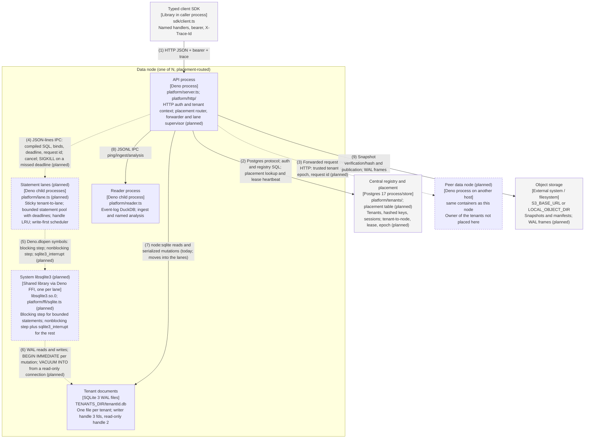

# Container — data node with statement lanes

Proposed design, not landed code: the FFI execution layer from
[lang-switch-fable.md](../../architecture/lang-switch-fable.md) combined with the scale-out pick F from
[scale-out-final-fable.md](../../architecture/scale-out-final-fable.md). Baseline `main` at `e808983`
(2026-10-12). Solid boxes and solid edges exist on `main`; dashed boxes and dashed edges marked **(planned)**
do not. Both formats are generated from `diagrams/c4-container-ffi.py`; numbered relationships are identical.

## Relationships

| # | From                        | To                             | Relationship                                                                                              |
| - | --------------------------- | ------------------------------ | --------------------------------------------------------------------------------------------------------- |
| 1 | Typed client SDK            | API process                    | HTTP JSON + bearer + trace                                                                                |
| 2 | API process                 | Central registry and placement | Postgres protocol; auth and registry SQL; placement lookup and lease heartbeat                            |
| 3 | API process                 | Peer data node (planned)       | Forwarded request over HTTP: trusted tenant id, epoch, request id (planned)                               |
| 4 | API process                 | Statement lanes (planned)      | JSON-lines IPC: compiled SQL, binds, deadline, request id; cancel; SIGKILL on a missed deadline (planned) |
| 5 | Statement lanes (planned)   | System libsqlite3 (planned)    | Deno.dlopen symbols: blocking step; nonblocking step; sqlite3_interrupt (planned)                         |
| 6 | System libsqlite3 (planned) | Tenant documents               | WAL reads and writes; BEGIN IMMEDIATE per mutation; VACUUM INTO from a read-only connection (planned)     |
| 7 | API process                 | Tenant documents               | node:sqlite reads and serialized mutations (today; moves into the lanes)                                  |
| 8 | API process                 | Reader process                 | JSONL IPC ping/ingest/analysis                                                                            |
| 9 | API process                 | Object storage                 | Snapshot verification/hash and publication; WAL frames                                                    |

## Runtime notes

Today the API process opens every tenant file itself through `node:sqlite` (edge 7) and the reader child is
the only other process. In the proposed design the API process keeps HTTP, auth, the reader client and the
backup pipeline, gains the placement router and forwarder (edges 2 and 3) and a lane supervisor (edge 4), and
stops touching tenant files; edge 7 is retired when the lanes land. A lane is a supervised child process in
the pattern of the reader child (`platform/ipc.ts`, `platform/layers.ts`): JSON-lines over stdio, killed and
respawned by the supervisor. Lanes exist because a child process is the only unit that can be killed
mid-statement (Worker.terminate() waited 24.9 s), that isolates a native crash from the API, and that has its
own descriptor table; they are not the cancellation mechanism, which is `sqlite3_interrupt` inside the lane
(edge 5). Each lane loads the system `libsqlite3.so.0` with `Deno.dlopen` (edge 5): a blocking step for
statements with a bounded plan (measured 6 to 7 µs per point read) and a nonblocking step on a pool thread for
the rest (44 to 69 µs, cancellable in about 0.4 ms). The hot write never waits behind reads: a mutation takes
only its own file's writer lock, and snapshots run on a read-only connection (edge 6). Placement (edges 2
and 3) is the scale-out pick F: a `placement` table beside the tenant row, lease-fenced, epoch-versioned; a
node that receives a tenant it does not own answers WrongOwner and the forwarder refreshes once. Measurements
and sources: `docs/architecture/lang-switch-fable.md` §3, `docs/architecture/scale-out-final-fable.md`.
