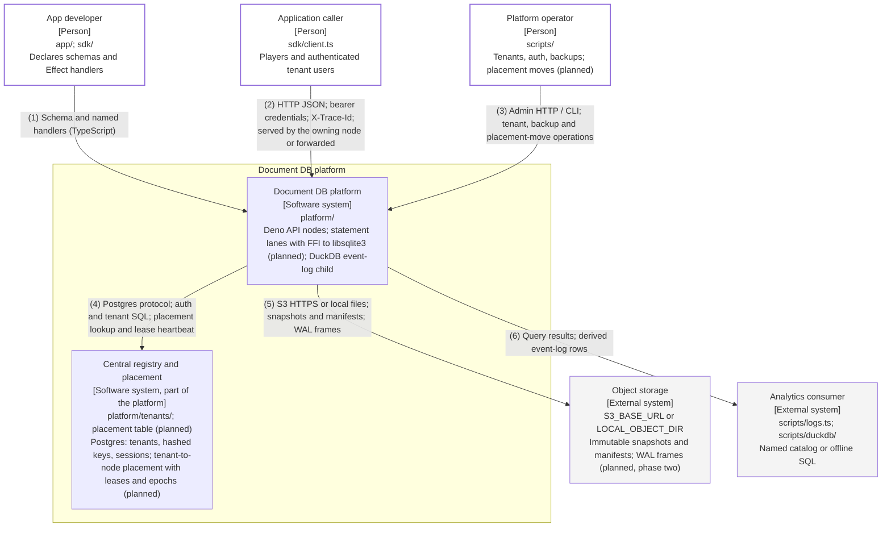

# System Context — FFI execution layer and tenant cells

Proposed design, not landed code: the FFI execution layer from
[lang-switch-fable.md](../../architecture/lang-switch-fable.md) combined with the scale-out pick F from
[scale-out-final-fable.md](../../architecture/scale-out-final-fable.md). Baseline `main` at `e808983`
(2026-10-12). Solid boxes and solid edges exist on `main`; dashed boxes and dashed edges marked **(planned)**
do not. Both formats are generated from `diagrams/c4-context-ffi.py`; numbered relationships are identical.

## Relationships

| # | From                 | To                             | Relationship                                                                      |
| - | -------------------- | ------------------------------ | --------------------------------------------------------------------------------- |
| 1 | App developer        | Document DB platform           | Schema and named handlers (TypeScript)                                            |
| 2 | Application caller   | Document DB platform           | HTTP JSON; bearer credentials; X-Trace-Id; served by the owning node or forwarded |
| 3 | Platform operator    | Document DB platform           | Admin HTTP / CLI; tenant, backup and placement-move operations                    |
| 4 | Document DB platform | Central registry and placement | Postgres protocol; auth and tenant SQL; placement lookup and lease heartbeat      |
| 5 | Document DB platform | Object storage                 | S3 HTTPS or local files; snapshots and manifests; WAL frames                      |
| 6 | Document DB platform | Analytics consumer             | Query results; derived event-log rows                                             |

## Runtime notes

What exists on `main`: one API node holding every SQLite handle through `node:sqlite`, the Postgres registry
for tenants, keys and sessions, the DuckDB reader child, snapshot backups to object storage. What is planned,
inside the same system boundary: statement lanes (child processes) that execute SQLite through Deno FFI to the
system `libsqlite3`, a placement table in the existing Postgres so any node can forward a request to the
tenant's owner, and WAL frames shipped to object storage after the snapshot path. No new external system is
introduced: the forwarded hop is node-to-node inside the platform, and the caller contract
(`createClient(baseURL, appId, token)`) is unchanged. k6 and the migration/tenant CLIs are unchanged and
omitted here for focus; see `docs/architecture/c4-context-document-db.github.md` for the audited landed
context.
